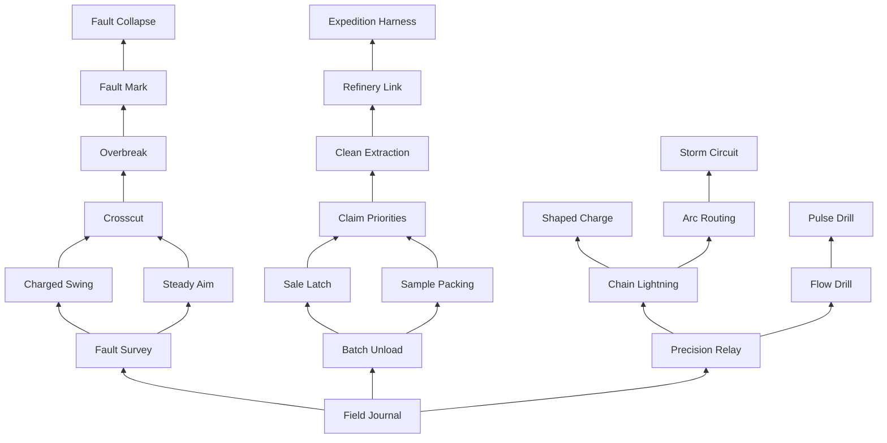

# Phase 5A: player progression, skill tree and rebirth

Status: **Phase 5B authorized development implementation**, pending user gameplay and visual review. The user approved the revised specification at commit `61fea9c446e4c071ee3c11422dfc09d33814a14a` with these controlling overrides:

- T(L)=200L+20L²+floor(L⁴/10) is provisional configurable balance; levels 0..100 and P(0)=0, P(L)=1+floor(L/2)+floor(L/10) are implemented for this checkpoint.
- **No lifetime-level 60/85 equipment purchase gates.** Existing equipment purchasing is preserved.
- **XP multiplier = 1.** Rebirth requirements 10,20,...100,then100 remain agreed design. The diminishing-benefit formula and arbitrary-precision proposal below are historical, **NOT APPROVED and NOT IMPLEMENTED**. No rebirth transaction or misleading benefit preview.
- Exactly A1/A2/A3/B1/B2/C1/C2/C3, all their specified ranks, plus the genuine tree and original node/common art. Remaining mechanics are PLANNED; this is an unpublished checkpoint, not a capped or completed public progression release.
- No reset, migration, codes, grants, tests, Play/Run or publishing. Legacy profile compatibility fails closed without rewriting old data; the existing memory-only Studio preview starts new progression at L0 with no skills and retains unrelated existing preview behavior.

See [Phase 5B handoff](PHASE_5B_HANDOFF.md) for exact implementation, assets, compatibility and review limitations. Prior gameplay and persistence checks are still unverified. The later design sections retain their historical arithmetic for review; they do not override these decisions.

## 1. Responsibilities and corrected source assumptions

Credits buy durable equipment; actual excavation earns levels and build points; voluntary rebirth resets that personal build for a bounded permanent XP benefit. Strong equipment remains useful. Neither selling access nor baseline controls are taken away to manufacture desirable skills.

| System | Responsibility and rebirth treatment |
| --- | --- |
| Equipment | Existing owned Pickaxe, Drill and Explosive, and per-tool Power, Speed, Capacity, Precision, Yield, Value and Critical purchases. Existing credits/prices/purchased ranks remain. No lifetime-level purchase gates; preserve all current purchasing rules. |
| Level | Levels 0..100, effective damage as the single XP source. Level/XP reset to 0 on rebirth; no buying XP or compulsory training. |
| Skill tree | 21 mechanics, 33 rank purchases, 96 points to fully rank everything; level 100 supplies 61 points. Ranks/allocations reset. Free respecs. Not a duplicate equipment percentage ladder. |
| Rebirth | No hard count limit in the agreed requirement direction. Permanent benefit remains unapproved; no transaction in Phase 5B. XP multiplier is 1. Historical benefit arithmetic below is not implemented. |
| Permanent acquisitions | Equipment, strength, creatures, inventory, currencies, cosmetics, achievements, worlds and acquired permanent buffs remain. Temporary skill effects never become permanent. |

Focused read-only source review: ExcavationService, ProgressionRules, ExcavationConfig, UpgradeEconomy, MaterialRewards, ResearchProfiles, DiscoveryCatalog and the existing EggRewards contract. No gameplay code executed.

- **Sell correction:** `ExcavationService.station` checks a loaded writable profile, living character and existence of SellTerminal; it does not check distance. The remote uses a 0.25s station-request throttle. The StationRange check elsewhere advances tutorial proximity progress; it is not Sell authorization. Sell awards `floor(materialValue*(1+ValueLevel*0.02)+0.5)`, empties actual contents, advances the existing Sell contract and synchronizes/drains pending. Preserve this freely available action. Remove Quick Deposit, Field Dispatch and Team Chute. No invented distance, channel, fee or cooldown restriction on normal Sell.
- **Drill correction:** one validated immediate damage tick per request, limited by the existing interval (0.38s default, 0.18s upgraded minimum). Flow belongs to continuous player excavation, not one section's lifetime. Breaking a section is productive work, not cancellation.
- **XP correction:** current level is `floor(sqrt(max(0, xp)/60))+1`; section breakers receive 2 XP, deepest breakers another 4, completed contracts 30, and eligible online contributors 100 at completion. Replace all these XP writes together with damage XP in a later approved implementation. Keep non-XP cash/relic/sample/contract/creature policies. End results show already-earned XP, not another grant.
- **Equipment:** preserve ownedTools, toolLevels, active aliases and SwitchTool behavior. Prices remain existing rounded geometric sums. Nodes reference only today's three families, never fictitious future ownership. Learning a technique does not grant a tool.
- **Strength/creatures:** retain `1+min(1, strength*0.0001)+equippedCreature.Power` (existing 0.08/0.16/0.30 creature bonuses). Optional training stays +1 strength per completed 2.5s cycle, cap 10,000, zero player XP/points. No level/node/rebirth requires training.
- **Materials:** preserve effective-damage sharing, one combined Yield bonus pool, original unit values and pending claims. Conditional Yield below joins that pool, not a separately rounded award. Packing/transfer changes are explicit; they never discard claims or permit mining while effectively full/pending.
- **Persistence:** extend the existing loaded/session-locked profile, not a second inventory/save service. Studio preview is memory-only with pre-existing grants; it proves no production durability. No offline profile writes.

The requested one-time full published-progress reset and redeem codes remain separate roadmap operations. Recommend production activation of the new schema only with that separately authorized reset, without retention/migration of old progress. Do not reset/convert inside Normalize. Preparation in the original Studio place can precede that operation; legacy schema must not silently be treated as fresh progression. The owner reports manually publishing prior work; do not assume live is older.

## 2. XP, levels, points and long-term pace

### Contribution XP

For accepted integer HP removed d: `baseXP=d/25*eggXpFactor`; `earnedXP=baseXP*M(R at the hit)`.

| Existing egg | HP multiplier | Proposed XP factor | Base XP/HP | Whole shell-section example |
| --- | ---: | ---: | ---: | --- |
| Ancient Bronze | 1 | 1.00 | 0.040 | 180 HP -> 7.2 XP |
| Gilded Sovereign | 2.6 | 1.15 | 0.046 | 468 HP -> 21.528 XP |
| Volcanic Heart | 6 | 1.30 | 0.052 | 1,080 HP -> 56.16 XP |

Do not multiply by durability again: harder sections already contain more HP. All layers/tools use this rule. Tick/detonation count, crit labels and final-hit identity are not XP sources. Eligible secondary damage earns XP for actual additional HP only. No overkill, rejected hits, duplicate actions or client effects. A 144/36 HP split on Bronze gives 5.76/1.44 base XP regardless of final hitter; a 100-damage attempt into 36 remaining HP earns only 1.44.

Zero XP from break/completion/contract callbacks, sales, collection/pending delivery, training, equipment purchases, idle time or reopening results. Keep their non-XP rewards. Removing the old 100-XP stipend is an explicit proposed change, not already applied. Results label per-egg XP **already credited**, with hit-time multipliers; rebirth during that egg never regrants earlier XP or changes contribution/creature odds.

Award in the same non-yielding authoritative mutation as effective damage, to a legitimately loaded writable actor profile. No offline settlement/replay of damage XP on rejoin. Use 10,000 subunits per XP plus the exact fractional accumulator under rebirth: base per-HP subunits 400/460/520. Carry fractions across hits, never round each hit independently. Group cosmetic receipts at most twice/second. No skill-tree XP multiplier or hidden idle catch-up grant.

### Exact curve and point schedule

New/rebirthed players: **L0, XP0, points 0**.

`T(L)=200*L+20*L^2+floor(L^4/10)` for integer L=0..100.

`XP required L -> L+1 = T(L+1)-T(L)`.

Level is the largest threshold reached; run XP caps at **T(100)=10,220,000**. Show MAX, no overflow bank or forced reset. Normal material/currency/creature rewards continue. Replace the existing displayed ResearchLevel interpretation; no competing level system.

`P(0)=0`; for L>=1, `P(L)=1+floor(L/2)+floor(L/10)`.

One point at L1, one every even level, plus one extra each ten-level milestone: **61 at L100**. Available points = entitlement minus valid allocated rank costs. Recompute server-side, not repeatable level-up event grants. Rebirth returns entitlement to 0; free respec returns spent points only.

| L | Total XP | Points | Meaningful access, not free grants |
| ---: | ---: | ---: | --- |
| 0 | 0 | 0 | Ordinary tools, free Sell and useful baseline UI |
| 1 | 220 | 1 | Choose a root; open the genuine tree |
| 5 | 1,562 | 3 | Passive lightning or charged swing; first active slot |
| 10 | 5,000 | 7 | First rebirth, or keep advancing to later mechanics |
| 15 | 12,562 | 9 | Continuous drill, packing and accuracy choices |
| 20 | 28,000 | 13 | Root second ranks; second rebirth threshold |
| 30 | 105,000 | 19 | Crosscut, claim priorities, shaped charge; second active slot |
| 40 | 296,000 | 25 | Second accuracy/packing/Flow ranks |
| 50 | 685,000 | 31 | Overbreak, precision salvage, lateral drilling |
| 60 | 1,380,000 | 37 | Planned mid-tree second ranks; no equipment purchase gate |
| 75 | 3,291,562 | 45 | Cooperative fault marks, independent refinery, arc routing |
| 85 | 5,381,562 | 51 | Larger build budget; equipment purchasing remains unchanged |
| 90 | 6,741,000 | 55 | Advanced mark/refinery/routing configurations |
| 100 | 10,220,000 | 61 | Choose up to two distinct capstones; full build budget |

The curve sets a budget, not the content. Each tier adds different aiming, secondary-contact, sustained drill, handling or cooperative mechanics. There is no hundred-rank damage ladder or arbitrary published L20 ceiling.

### Historical equipment gate proposal — rejected for Phase 5B

XP alone cannot prevent unusually high income from maxing equipment. Recommend explicit **new-purchase-only gates**, using permanent highestLevelReached (retained through rebirth):

- Ranks <= floor(0.8*configuredMaxRank): today's credit-only availability.
- Above that through floor(0.9*configuredMaxRank): lifetime highest level >=60.
- Remaining ranks: lifetime highest level >=85.

For Power/Speed max 50: 1..40 credit-only, 41..45 require lifetime L60, 46..50 lifetime L85. Apply each key's actual max. Prices, ownership and already purchased ranks remain; never revoke a rank. No tool-ownership level gate. These are permanent access milestones, not skill ranks or currency. Show requirements before purchase. **This addition needs approval**, not assumed to exist.

Players can invest in most ranks and different families immediately, then pursue final ranks over sustained play. Rebirth preserves all earned access. Source-cost illustration: full current Drill Power approximately `72*(1.12^50-1)/0.12=172,801` credits, Speed approximately `96*(1.14^50-1)/0.14=479,474`, before rounding each price, plus existing 18,000 ownership cost. This is not measured earning time. Purchase gates make the long-term goal explicit rather than pretending unknown current income guarantees it.

### Arithmetic pace assumptions, not measured balance

Planning ordinary first session: **45..60 minutes**, not a forced duration. Rates below are assumed effective **base XP/min before M**, including aim, targets, selling and equipment investment. No training is required. These are formula evaluations, not tests, simulations or telemetry.

| Situation | Arithmetic | Illustrative time |
| --- | --- | --- |
| Starter -> L1 | 220 / 60..100 base XP/min | 2.2..3.7 min |
| Starter -> L5 | 1,562 / 60..100 | 15.6..26 min; signature unlock |
| First rebirth, L10 R0 | 5,000 / 60..100 | 50..83 min; not maximum level/equipment/all unlocks in the first session |
| Second, L20 R1 | 28,000/(7/6)=24,000 base XP; retained gear 400..800/min | 30..60 min |
| Third, L30 R2 | 105,000/(9/7)=81,666.67; gear 800..1,600/min | 51..102 min |
| Experienced R0, L30 -> L60 | (1,380,000-105,000)/3,000..6,000 | 212.5..425 min across sessions |
| Veteran R0, L60 -> L100 | (10,220,000-1,380,000)/6,000..12,000 | 736.7..1,473.3 min across sessions |
| Tenth, L100 R9 | 10,220,000/(23/14)=6,220,869.57; veteran 6,000..12,000/min | 518.4..1,036.8 min, about 8.6..17.3 hours |
| Fifty-first, L100 R50 | 10,220,000/(21/11)=5,353,333.33; same veteran rate | 446.1..892.2 min, about 7.4..14.9 hours |
| Very many rebirths | M<2: L100 always needs >5,110,000 base XP | >425.8..851.7 min at those rates; cycles do not tend to zero |

Equipment acceleration matters: current max Drill B with max strength/Ember is `floor((55+50*4)*2.3)=586`. Max precise chain multiplier 1.85 and crit 25% give expected requested damage `586*1.85*1.125=1,219.6125` per tick. At 0.18s and Volcanic XP factor this is **21,139.95 base XP/min**, before overkill, interruptions and skills. This is source arithmetic, not observed DPS. Ideal Flow rank 2 averages at most 1.15x primary requested damage over a 4s build/3s boost cycle (`1+0.35*3/7`) before losses. Blasts/passive secondaries also matter; the Drill calculation is not a universal ceiling.

Even an optimistic **40,000 base XP/min** and M almost 2 gives `10,220,000/80,000=127.75 minutes` per full L100 run. This is a stress assumption, not a proven rate bound. A new R0 profile would need 134.5 minutes at that unrealistic-from-start rate to reach the L85 equipment gate. Actual acceptance needs the owner's manual observations of retained max gear, free Sell, packing and multiplayer targets. If those invalidate targets, review curve/ability/economy interactions explicitly; do not add sale friction, paid relief or idle waiting.

After L100: finish selected branch ranks, freely experiment with capstone combinations, finish alternate equipment investments, pursue the existing rare creature collection, or voluntarily rebuild with more XP efficiency. Retaining a completed build is valid. Future visible achievements, home/incubation and worlds add separately scoped goals; they are not claimed present. Late diminishing rebirth gains are honestly small, not disguised as dramatic upgrades.

## 3. Revised connected tree: 21 mechanics, 33 ranks

Seven nodes per branch. Free Field Journal hub at (0,0); positions are logical canvas coordinates. Branch centers x=-600/0/600. C3/C4/C5 are optional current-tool spurs, not prerequisites for the starter-compatible lightning path. Every prerequisite means rank >=1 of each listed node.

Common budget per branch: N1 two ranks x 1 point, N2 one x 2, N3 two x 2, N4 two x 3, N5 one x 4, N6 two x 4, N7 one x 6 = **32 points / 11 ranks**. All branches: **96 points / 33 ranks**. Twenty-one mechanics plus twelve additional refining ranks, not 33 advertised separate abilities.

At 61 points, fully rank any one branch and spend 29 elsewhere, or spread points. Two fully maxed branches cost 64 and cannot both fit. A visible additional rule permits **at most two purchased capstones**, including via the cheaper C route. No extra points from rebirth count. Every listed rank resets at rebirth. Free full respec in the player's room after 10s without mining, no pending action and a writable profile; 60s respec throttle, refund spent points only, retain active cooldowns. No credits/consumables.

Level requirements mean current-run level, not lifetime. Existing tools are needed to **use** their techniques, never granted by learning. Buying a currently-unowned tool's technique displays that warning; these optional spurs do not block pickaxe access to lightning/routing/circuit or the A/B paths. No future family or invented owned tier.

Damage vocabulary: `B=floor((base Power+purchased Power*PowerStep)*(1+strengthBonus+creatureBonus))`. D is B times existing precision/chain and critical multipliers before HP rounding/clamping. Secondary damage uses its stated B fraction without another precision/crit roll. All actual HP enters the existing material, XP and creature-contribution path once. Rank values replace prior ranks, not rank 1+rank 2 stacked. All nodes below reset on rebirth, with cooldown exceptions in section 4.

### A. Excavation and impact

| Stable ID / name / position | Prerequisites; current level; cost per rank; max rank | Exact effect and equipment interaction | Feedback / original icon intent |
| --- | --- | --- | --- |
| A1 `impact.fault_survey` / Fault Survey / (-600,-180) | Hub; L1/L20; 1; 2 | Mark 2/4 other visible exposed sections at <=35% HP within 8/12 studs of aim contact. <=4 updates/s, order HP fraction then ID. No X-ray/stat increase; free target HP/precision UI stays free. | Local seam brackets; lens over ceramic fracture. |
| A2 `impact.charged_swing` / Charged Swing / (-600,-360) | A1; L5; 2; 1 | Pickaxe active: 0.45s windup, one 1.60*D strike; 8s technique cooldown plus normal tool cadence. Uses purchased Power/Precision/Critical once; no movement freeze or overkill credit. | Readable anticipation/downswing; weighted pick head and arc. |
| A3 `impact.steady_aim` / Steady Aim / (-600,-540) | A1; L15/L40; 2; 2 | Ordinary Pickaxe/Drill precision radius 1.00/1.20 studs instead of 0.75. Does not increase multiplier/guarantee crit; equipment Precision still determines precision reward. Explosive radius unchanged. | Honest larger contact ring; pick tip centered in ceramic inset. |
| A4 `impact.crosscut` / Crosscut / (-600,-720) | A2 AND A3; L30/L60; 3; 2 | Alternate Charged Swing mode, same slot/windup/8s cooldown: primary 1.20*D plus <=2 side sections each 0.35/0.45*B, within 4 studs in a 60-degree surface-tangent fan. Replaces single 1.60 mode. Snapshot original exposed layer before damage. | Short lateral follow-through/two accents; pick across three facets. |
| A5 `impact.overbreak` / Overbreak / (-600,-900) | A4; L50; 4; 1 | Ordinary pickaxe killing hit: transfer `min(unused requested damage,0.40*B)` to <=1 already-eligible neighbor within 4 studs; 4s ICD. Unused damage itself earns nothing, only actual neighbor HP. No technique/secondary trigger. | One carried contact accent; fracture reaching another seam. |
| A6 `impact.fault_mark` / Fault Mark / (-600,-1080) | A5; L75/L90; 4; 2 | Charged Swing leaving primary alive marks it 6/8s. First later ordinary hit by ally, or owner after 0.6s, triggers owner's secondary 0.30/0.40*B, B snapshotted at mark. 8s mark ICD, one mark per owner/section. Owner must remain alive/writable, same tool/round/layer, in mining reach and capacity-eligible; otherwise no damage. | Wedge notch/owner cue; two tool tips meeting a wedge. |
| A7 `impact.fault_collapse` / Fault Collapse / (-600,-1260) | A6; L100; 6; 1 | Capstone: valid mark release may hit <=2 neighbors snapshotted at placement, within 4 studs, each 1.25*B. Recheck visibility/eligibility at release, no replacements/new layer. 12s capstone ICD; ordinary mark works if unavailable. | Three-seam collapse, no screen flash; braced ceramic arch. |

Fault-mark damage belongs to its owner only after actual validated HP removal; triggering player keeps their own hit. No reward for merely placing a mark. Different owners cannot queue multiple mark releases on one root action: earliest accepted still-valid mark releases, others wait for another trigger/expiry. Renewing never stacks an owner's marks. Crosscut fan uses primary tangent plane and projected player facing; degenerate projection uses projected right vector.

### B. Collection and efficiency: useful beyond today's free Sell

| Stable ID / name / position | Prerequisites; level; cost per rank; max rank | Exact effect and equipment interaction | Feedback / original icon intent |
| --- | --- | --- | --- |
| B1 `collection.batch_unload` / Batch Unload / (0,-180) | Hub; L1/L20; 1; 2 | Explicit Sell processes <=2/3 actual bucket loads: sell, drain pending to capacity, repeat only to cap, final normal drain. Each load uses original values and existing Value calculation/rounding. No unlimited loop. Fewer taps to clear earned backlog anywhere Sell works. | Receipt by load/pending left; buckets at sorting chute. |
| B2 `collection.sale_latch` / Sale Latch / (0,-360) | B1; L5; 2; 1 | Optional passive toggle, default off. While mining input is held/toggled and an accepted positive-damage action occurred within 3s, full bucket triggers one normal one-load Sell and drain. 8s ICD; cannot retrigger just because pending refills it. Does not invoke Batch Unload; evaluate only after the entire root-action/secondary settlement, never between blast sections. Never mines while full; manual free Sell remains. | Latch indicator/actual receipt; clasp opening above bucket. |
| B3 `collection.sample_packing` / Sample Packing / (0,-540) | B1; L15/L40; 2; 2 | For n units of one resource, occupied slots: R1 `4*floor(n/5)+n%5`; R2 `3*floor(n/4)+n%4`. Sum across resources. Counts/values unchanged. Unlike flat equipment Capacity, packing rewards homogeneous loads and changes pending-fit decisions; no extra units. | Slots-used and actual units in bag detail; nested mineral trays. |
| B4 `collection.claim_priorities` / Claim Priorities / (0,-720) | B2 AND B3; L30/L60; 3; 2 | R1: FIFO or highest-original-unit-value pending-first. R2: optional chosen-resource priority, remaining ties FIFO. Reorder only undelivered claims, never reprice. Chooses which earned lots enter limited space first; no pending-gate bypass. | Order selector at existing pending indicator; mineral sorting lanes. |
| B5 `collection.clean_extraction` / Clean Extraction / (0,-900) | B4; L50; 4; 1 | Ordinary precise direct hits add+1 to hit-time Yield bonus. Existing damage weighting and once-rounded combined pool apply; non-precise/secondary hits add 0. Not an extra whole unit per hit/player/section. Purchased Yield stays additive in the same formula. | Stabilized sample accent on confirmed award; ceramic sample cradle. |
| B6 `collection.refinery_link` / Refinery Link / (0,-1080) | B5; L75/L90; 4; 2 | R1: designate one actually owned tool's Value level for sales independent of held tool. R2: optionally choose highest owned Value automatically, ToolOrder tie-break. Replaces rather than multiplies held-tool Value; original materialValue unchanged. Retains invested refinery usefulness when mining with another tool. | Sale preview names refinery; tool-to-mineral coupling. |
| B7 `collection.expedition_harness` / Expedition Harness / (0,-1260) | B6; L100; 6; 1 | Passive capstone: other living players within 12 studs and visible to owner can use packing rank 1 or their own stronger rank. No stacking, points, ownership or contribution/XP/cash for provider. Owner keeps their own purchased packing. | Discrete affected-bucket link, no particle cloud; linked pack straps. |

Packing requires one common server occupancy/fit function in hits, claims, sales and HUD. Existing per-tool capacity becomes the slot limit; underlying units/materialValue remain. If switching, respec, rebirth or aura departure removes packing/capacity, **retain all units/value**, display OVER CAPACITY, stop new mining/drains, allow normal Sell. No deletion, repricing or second inventory. Pending lots keep original unit values. Sale Latch cannot unattended-sell an offline backlog: it needs recent actual damage, cannot chain itself and never issues an attack or aims.

B1/B2 reduce interruptions, B3 changes composition, B4 chooses claim order, B5 rewards careful extraction, B6 decouples existing refinement from tool handling, B7 helps teammates. No node sells remote access already free. Existing Sell contract counts actual nonempty operations (including each actual B1 load), never empty iterations. Its cash remains; its old XP is removed with other legacy XP writes.

### C. Tool techniques: passive signature and continuous excavation

| Stable ID / name / position | Prerequisites; level; cost per rank; max rank | Exact effect and equipment interaction | Feedback / original icon intent |
| --- | --- | --- | --- |
| C1 `technique.precision_relay` / Precision Relay / (600,-180) | Hub; L1/L20; 1; 2 | After ordinary Pickaxe/Drill section break, carry earned precision-chain count to next precise hit on another section in same layer within 3/5s and 4 studs. Still requires accurate contact; non-precise next hit consumes without benefit. Existing chain cap 3; 6s ICD. | Next-seam bracket; tool carrying a fissure onward. |
| C2 `technique.chain_lightning` / Chain Lightning / (600,-360) | C1; L5; 2; 1 | **Passive**, ordinary Pickaxe/Drill only: 25% on first qualifying positive root action in each fixed 4s server window, if 8s proc ICD ready. <=2 secondary targets, 0.80*B then 0.50*B; each hop<=4 studs, total<=6 from origin, same exposed layer. Snapshot before root. No button or explosion multi-roll. | <=2 arcs,0.18s; Reduced Effects endpoint sparks; mineral conductor. |
| C3 `technique.core_drill` / Flow Drill / (820,-540) | C1; L15/L40; 2; 2 | Passive drill mode: build 4s validated ordinary work **across targets**; next 3s valid ticks deal 1.25/1.35*D. No spool pause/additional attack loop. Breaks preserve enhancement; then rebuild from 0. Owned Drill needed to use, not granted. | Continuous contact/flow meter, bit accent; drill along mineral ribbon. |
| C4 `technique.shaped_charge` / Shaped Charge / (820,-720) | C2; L30/L60; 3; 2 | Explosive active: radius 3, cap 3, center 1.25/1.40*D, linear falloff to 0.50 at edge, fuse 0.45s;10s technique cooldown plus existing tool cadence. Replaces ordinary 6/7/0.35 placement for this action. Narrower area is explicit tradeoff. | Narrow footprint/focused blast; concave charge liner. |
| C5 `technique.pulse_drill` / Pulse Drill / (820,-900) | C3; L50; 4; 1 | Alternative Flow mode: same 4s build/3s duration, ordinary primary D plus <=1 eligible neighbor within 4 studs at 0.25*B each tick. No pause. Choose focused OR lateral in tree/loadout, no combat button. Snapshot each tick, no layer cascade. | Small lateral contact arc; drill tooth/pressure ring. |
| C6 `technique.arc_routing` / Arc Routing / (600,-1080) | C2; L75/L90; 4; 2 | R1 adds third hop 0.30*B, total 4 targets including primary, same hop/origin limits. R2 permits fork mode: <=2 first targets each 0.65*B within 4 of origin, one distinct final target 0.30*B within 4 of either branch/6 of origin. Choose chain OR fork; chance/ICD unchanged. | <=3 brief arcs; mineral routing junction. |
| C7 `technique.storm_circuit` / Storm Circuit / (600,-1260) | C6; L100; 6; 1 | Passive capstone: successful lightning marks surviving hit endpoints 6s. Next 2 ordinary positive root hits by owner on an endpoint may each discharge 0.75*B to up to two distinct other surviving marked endpoints, <=1 discharge event/s. Original layer/range/visibility, no new endpoints. Discharges cannot proc lightning/recreate circuit. No valid pair means no bonus. | Two remaining-charge notches; loop of ceramic conductors. |

C3/C4/C5 are optional existing-tool spurs; no unavailable tool gates C2/C6/C7 or initial A/B paths. None grants future ownership.

### Drill continuity and equal-window comparison

Progress is per-player/round, not target. Each valid ordinary drill tick adds at most `min(server tool interval, elapsed since previous credit)` to buildup. First tick starts clock at zero. Credit requires actual accepted positive damage; no gain while contact/capacity is invalid. New targets after breaks are valid immediately. Gaps<=2s retain the meter but grant no catch-up time; longer gaps reset partial buildup. At 4s, the next valid tick starts a 3s wall-clock enhancement; ready expires after 4s. Breaks/retargeting do not cancel that window, but invalid targets receive zero damage. No building during enhancement. F/release, switch/unequip, death, blocking menu, round change clear meter/ready/buff. Mode changes only in room and clear progress. Normal tool cooldown always applies.

Ordinary damage continues during buildup; enhancement skips **zero ordinary ticks**. In the same window with N accepted ticks and sufficient HP:

- Ordinary = sum(D_i).
- Focused R1/R2 =1.25/1.35*sum(D_i), clamped per target. Powerful tools need no section to survive buildup.
- Lateral =sum(D_i)+0.25*sum(B_i on ticks with a valid neighbor). It trades focused damage for spread, not ordinary drilling time.

Example D=B=55, interval 0.38:8 ticks in [0,3) give 440 ordinary,550 focused R1,440+110=550 lateral if neighbors exist. At D=B=255, interval 0.18:17 ticks give 4,335 ordinary,5,852.25 focused R2,4,335+1,083.75=5,418.75 lateral. With precision/crits D>B, focused favors durable single targets; lateral can reduce overkill. No neighbors means lateral equals ordinary. These are requested-damage arithmetic examples; HP caps, rounding, contact and capacity govern actual results. No old 1.2s no-damage Pulse spool remains.

### Passive lightning rate and settlement guard

- One opportunity per `floor(serverTime/4)` window **per UserId**, not per tick/section. Keep consumed-window/last-proc guards across rejoin. No hit means a lost window, not banked chances. First ordinary positive root consumes window; if 8s ICD ready draw once at 25%, otherwise no draw. No second chance on later drill ticks after failure. 15 scheduled windows/minute before ICD losses (a boundary-straddling 60s interval can touch 16 windows); sustained pre-ICD expectation 3.75 successes/minute, not a measured rate.
- Pickaxe 0.60..0.30s and Drill 0.38..0.18s both fit inside 4s during valid continuous contact. Same window budget, not 1.7..3.3 versus 2.6..5.6 rolls/s. Gaps/ICD alignment affect realized rate; no exact-throughput claim. Power improves secondary damage; Speed does not create lottery tickets.
- Ordinary Pickaxe/Drill primary may roll. Flow primary is one ordinary root; Pulse primary may roll, its neighbor cannot. Charged/Crosscut/Shaped, explosions, marks, Overbreak, lightning/circuit secondaries never roll. Explosive keeps its existing area identity. No recursive ability.
- Snapshot neighbors before root HP mutation, nearest hop then stable ID, unique sections. Same current round/original exposed layer, nonpermanent/intact, valid surface visibility from origin/previous hop. No through-egg shortcuts. Apply only if root removes HP. Skip vanished targets without replacements/new layer. A success with no neighbors consumes ICD and shows one restrained spark, no fake reward.
- Recheck owner/profile/life/range/capacity; each actual secondary goes through effective damage and one-section settlement. No support credit, new creature chance formula or separate grant for the effect. Round damage once using existing HP rules; never manufacture a positive hit from computed zero. Sequence/round/source IDs prevent repeated effects/events applying twice.

## 4. Stacking, limits, controls and claims

1. Server validates profile lock, ownership, ranks/prerequisites, current level/points, tool compatibility, slot, life, round, reach/contact, exposed layer and cooldowns. Maximum two active slots: one L5, second L30. Modes change in room/UI; passives add no combat buttons. Charged/Crosscut share a slot; Shaped is the other main active. Free Sell and ordinary touch/desktop controls remain.
2. Root damage: existing B -> precision/crit D -> at most one active-mode multiplier OR ordinary Flow multiplier. No Flow*active stacking. Secondaries use snapshotted B without another crit/precision. Clean Extraction joins equipment Yield in the same hit-time weighted pool. Refinery Link replaces the sale Value source, never multiplies two tools' upgrades.
3. Shared secondary budget per root: max 7 distinct sections including primary/ordinary blast candidates. Snapshot the union before root damage. Order root, technique lateral contacts, fault releases, Overbreak, circuit, lightning; distance/ID within each category. One secondary entry per section/root: if effects select the same neighbor, earlier entry wins, no replacement. Proc/cooldown consumption is not refunded for exhausted budget. Attribute actual entries to their true owner, with no hidden-layer damage or duplicate grants.
4. Ordinary/Shaped explosives keep validated position, normal, round and original layer after target destruction. Snapshot once at detonation; ordinary HP damage and accepted-action cooldown. F/switch/unequip/death/menu/round cancel; original target destruction alone does not. Survivors retain partial HP/cracks.
5. No mining while effective packed occupancy is full or pending claims exist. Stable settlement order; once owner fills/creates pending, skip remaining damage. Earned claims remain, not unlimited full-bucket mining. Losing capacity/aura can leave legitimate excess: preserve it until free sale. Sell processes actual bucket contents only.
6. Cancel temporary effects/counters on release/death/round change/respec; knowledge lasts until respec/rebirth. Keep accepted action/proc/cooldown guards across switch, respec, death, rebirth and reconnect; save UTC deadlines/consumed windows as necessary. No temporary modifier becomes strength/permanent buff. Respec/loadout needs own room, 10s without mining, no pending action. Auto Sell alone is not a blocking menu; never issues an attack.
7. Presentation targets, not performance evidence: <=3 lightning arcs/proc,<=12 visible secondary accents/client,<=0.6s cosmetic life. Prioritize local/nearby hits. Reduced Motion removes shake/FOV kicks; Reduced Effects uses endpoints/factual numbers. No full-screen flash or permanent cloud. Keep existing audio; no invented/unrelated audio IDs.
8. Shared break effects once; personal receipts reflect actual delivered/pending rewards. Creature probability remains existing solo chance*final effective share. No aura-provider credit or last-hit advantage. Section cash/relic/sample/contract attribution remains current; only old section/contract/completion **XP** is replaced. Offline material/creature claims remain same-server memory until loaded-profile transfer, lost on shutdown if untransferred, not cross-server delivery.

## 5. Uncapped voluntary rebirth

Approved requirement with R completed rebirths:

`requiredLevel(R)=min(100,10*(R+1))`.

First L10, second L20, ... tenth L100. For exact-count implementation, compare R with 9 first: R>=9 directly gives 100, without multiplying a huge counter. Eleventh and every later rebirth still L100. No hard ten-rebirth limit, fee, timer, paid bypass or egg-final-hit requirement. Players may continue/stay at 100 instead.

### Historical permanent-benefit formula — NOT APPROVED

Recommend `M(R)=1+R/(R+5)=(2R+5)/(R+5)` for player XP only.

For R->R+1, `deltaM=5/((R+5)*(R+6))>0`.

Strictly increasing, diminishing marginal gains, **always below 2x**, never exponential multiplication. Existing strength/creature effects influence actual damage separately; M never modifies damage/materials/creature odds. No skill XP booster.

| Rebirth performed | Level | M before -> after | XP percentage-point gain | Base-equivalent XP for this run |
| --- | ---: | --- | ---: | ---: |
| 1st,0->1 | 10 | 1 ->7/6=1.166667 | +16.666667 | 5,000 |
| 2nd,1->2 | 20 | 7/6 ->9/7=1.285714 | +11.904762 | 24,000 |
| 3rd,2->3 | 30 | 9/7 ->11/8=1.375 | +8.928571 | 81,666.67 |
| 10th,9->10 | 100 | 23/14=1.642857 ->5/3=1.666667 | +2.380952 | 6,220,869.57 |
| 11th,10->11 | 100 | 5/3 ->27/16=1.6875 | +2.083333 | 6,132,000 |
| 51st,50->51 | 100 | 21/11=1.909091 ->107/56=1.910714 | +0.162338 | 5,353,333.33 |
| 101st,100->101 | 100 | 41/21=1.952381 ->207/106=1.952830 | +0.044924 | 5,234,634.15 |
| 1001st,1000->1001 | 100 | 1.995024876 ->1.995029821 | +0.000494545 | 5,122,743.14 |

After first/second/third rebirth, 100 base XP earns 116.6667/128.5714/137.5 including carried fractions. At R100 it earns 195.2381; R101 earns 195.2830. This is not a damage/loot grant. At extremely large counts gains are positive but small: disclose that rather than promising every late reset is dramatic. Keeping a full build is a valid choice.

### Historical numerical proposal — deferred, not implemented

Do not repeatedly multiply a stored bonus. Store R as a canonical nonnegative decimal integer string and derive exact numerator/denominator; use exact integer/rational XP accumulation. No gameplay count cap, floating-point overflow or silent saturation.

Base XP is integer 1/10,000 units. For fixed R maintain remainder q with denominator R+5: add `baseSubunits*(2R+5)`, divide by R+5 to credit whole subunits, retain division remainder. Run XP/subunits cap at T100. Rebirth explicitly resets run XP/fractions and increments R exactly. Later implementation needs reviewed arbitrary-precision decimal integer/division helpers, not a software install or code supplied now. Client approximations are display-only. Profile payload/resource failures must fail clearly without a reset/grant, never clamp the count and claim a benefit.

Confirmation shows current/next multiplier, **marginal percentage-point gain**, and XP per 100 base XP. Use adaptive decimals/scientific notation when needed, exact delta fraction in details. Never show +0.00% or two indistinguishable rounded 2x labels while claiming an improvement. Fractional accrual preserves actual entitlement instead of rounding small benefits away each hit. Bounded endless progression necessarily has tiny marginal gains eventually; this limitation is explicit, not disguised.

### Exact reset/retain contract

One serialized transaction in the loaded session-locked profile, guarded by request ID/run revision and existing save path. Validate living owner in their room, 10s without mining, no pending action, writable profile and actual level requirement. Confirm actual losses/retained items/current-next M/marginal gain; never default-confirm. Retried requests cannot increment twice. In-memory success is not verified durable persistence.

| State / proposed field | Rebirth action |
| --- | --- |
| xp, proposed XP subunits/fraction/denominator remainder | Zero; ResearchLevel 0; no overflow bank |
| progression.skillRanks and selected active techniques/modes | Clear all ranks and run loadout |
| Point entitlement/current-level milestone access/active-slot count (derived) | Zero at L0, re-earn by levels; unspent points do not carry |
| Drill meters/ready windows, marks, circuit endpoints, temporary movement/packing aura | Clear, never convert to permanent buffs; preserve excess carried goods |
| progression.rebirths | Exact+1, no hard limit; derive M |
| progression.runId/revision | Increment, reject stale purchases/respec/confirmation |
| Unexpired action/technique/proc/respec guards | Retain; no cooldown refill through reset/rejoin |
| progression.highestLevelReached | Retain maximum, permanent equipment access; not a skill buff |
| ownedTools, toolLevels, active upgrade aliases, selected tool, drillTrialUsed | Retain; flush active aliases into their tool before transaction; no refreshed trial |
| cash, income, contents, materialValue, pendingMaterials, samples, relics | Retain every unit/value/currency; no silent sale, deletion or currency reset |
| creatures, equippedCreature, discoveries, displaySlots, eggRewardReceipts, existing same-server claims | Retain, normal once-only transfer, no reroll |
| strength, other permanent acquired buffs, cosmetics/room themes/settings | Retain, remove only temporary skill effects |
| Tutorial/intro progress, contract index/progress | Retain, no replay grants |
| Current egg/section contribution and frozen settlements | Retain across personal rebirth; new damage uses new R, old claims unchanged |
| Existing/future achievements, trophies, unlocked worlds | Retain when present; grant none here |
| Profile/economy/progression schema and session locks | Service-managed, not reset/migrated by rebirth |

No other field resets by implication. This normal rebirth is distinct from the owner's separately requested one-time full published-progress reset. Neither executes in Phase 5A.

## 6. Dedicated tree-screen and art specification

Current HUD, menus and tool assets are **functional interim work, not approved final art**. Finalize revised mechanics before icon production. No artwork, boards, GIFs, video, Blender studies or uploads in this revision.

Dedicated pannable graph, never an upgrade-button list. Bounds x=-950..1050, y=-1450..120; hub/node coordinates above, amber impact/jade collection/violet-brass technique branches. Actual edges match server prerequisites; optional tool spurs visibly differ from main route. Branch focus and Recenter support the taller tree.

- Desktop safe width>=900:64px status strip, canvas plus 320..380px selected-node panel, 16px gutters. Panel: custom illustration, exact current/next effect, prerequisites/level, rank/cost/points, tool compatibility, equip/mode and one purchase action. Show two-capstone limit plainly.
- Portrait/narrow:<=88px status strip, canvas main view, bottom sheet 38% height expandable 70% or collapsed 56px. Scroll panel text only, never replace graph with list. Landscape may use 280px side panel. Recenter respects unobscured canvas.
- Mouse drag/wheel, touch drag/pinch; zoom 0.55..1.40 anchored at pointer/pinch;>8px drag suppresses tap. Nodes 88 logical units ->>=48.4px at minimum zoom; controls>=48px, text>=14px. Plus/minus/Recenter visible; pan clamped for recovery. Targets, not device-tested claims.
- Locked clasp/unmet prerequisite; available open rim/empty sockets; partial filled+empty sockets; complete engraved rim/all sockets. Color supplements shape/text. Insufficient points, unowned compatible tool and two-capstone limit are distinct reasons. Checkpoint-only missing nodes say PLANNED, never falsely functional or merely level-locked.
- Keyboard/gamepad graph-neighbor navigation, selection separate from purchase, focused node brought into view, accessible Back/Close/Recenter/zoom. No hover-only information. <=2 combat skill buttons; passives/modes add no combat hotbar overload. Free Sell stays independent.
- Header: actual L0..100, current/next XP, points, R, M. No invented loading balances. Rebirth uses explicit reset/retain/marginal-gain confirmation; no forced level-up modal. Purchase feedback one 0.25s rim/connector trace after server confirmation; Reduced Motion static receipt, Reduced Effects no extra particles. No camera lock/join cinematic.

Required final art: **21 original node icons**, hub, three branch emblems, rebirth emblem, four reusable node-frame states, rank sockets/clasp/focus/slot ribbons, two scalable panel frames, connector junctions, navigation/status marks and low-contrast workshop-map background. Node motifs above are briefs, not produced illustrations. Targets 512x 512 masters/256 exports readable 48px,1024 backdrop. No emoji, copied game art, generic symbols as final, rejected weapon designs or recolored default rectangles. Preserve polished playful silhouettes, intentional materials and readable highlights. Removed courier/chute skills need **no props**; future effects need restrained arc/endpoint/wedge art and authored poses on existing tools.

Previously inspected capabilities: raster image generation and Studio upload_image (HTTP URL->asset IDs) exposed; store_image is a local reference, not upload. Ownership/permissions, HTTP serving, moderation and experience access remain unverified. No layered illustration editor or Blender/BlendRelay connection established here. Do not promise layered masters from generated PNGs. Preserve actual authored vector/layers, bitmap masters/provenance, exports and manifest mapping stable IDs to hashes/dimensions/returned IDs/owner/permissions. Proposed assets/ui/progression/source, exports, manifest.json remain future paths, not files created now. No installs; later upload access may need an owner action.

Final illustrated equipment/upgrade screens remain separately unmet. A functional tree checkpoint does not establish final visual quality. Produce the icon set only after mechanics approval.

## 7. First milestone and exact follow-ons

### Authorized Phase 5B: signature excavation and genuine tree

A development checkpoint **in the original Studio place**, not a separate place or published partial release:

1. Server XP/points foundation with the full **0..100** curve and highest-level record; replace legacy XP writes together, report already-credited egg XP. No arbitrary L20 cap. Preserve equipment purchase rules; the proposed lifetime-level gates are not approved.
2. Actual pannable connected tree, prerequisites, free respec and level-based slot rules. Exactly eight implemented nodes, all listed ranks: **A1 Fault Survey, A2 Charged Swing, A3 Steady Aim, B1 Batch Unload, B2 Sale Latch, C1 Precision Relay, C2 passive Chain Lightning, C3 Flow Drill**. Lightning at L5: C1 cost 1+C2 cost 2=P5=3; works with starter pickaxe, no Drill/Explosive/future ownership prerequisite.
3. Lightning window/ICD, exposed snapshot, contribution/claims/cancellation and bounded feedback; drill flow across successful breaks. These signature behaviors are required, not deferred behind a utility-only release.
4. Eight illustrations/common graph kit after mechanic approval, or explicit art-incomplete status if blocked. Other nodes show PLANNED/no purchase. Rebirth is deferred: no multiplier preview or transaction; XP multiplier is explicitly 1. Never pretend incomplete mechanics shipped.
5. User manual review: signature feel, retargeting/breaks, shared rewards, near-full bucket/free Sell, invalid point requests, respec, rejoining and desktop/touch graph. No agent tests, gameplay automation or artificial save/resources.

This is **not a public-ready complete progression release** while rebirth/later nodes are missing. No low player-facing level ceiling substitutes for that work. Previewing higher levels does not authorize test save manipulation. Finish the following separately approved checkpoints before considering release:

- **5C — rebirth and materials:** uncapped exact-count rebirth/save guards and reset/retain behavior; B3 Packing, B4 Claim Priorities, B5 Clean Extraction, B6 Refinery Link, including excess-capacity retention and value accounting. No data reset/migration hidden inside rebirth.
- **5D — advanced tool play:** A4 Crosscut, A5 Overbreak, A6 Fault Mark, C4 Shaped Charge, C5 Pulse Drill, C6 Arc Routing; shared budgets/stacking/high-level input/art. Existing tool families/models.
- **5E — capstones and complete L100 delivery:** A7 Fault Collapse, B7 Expedition Harness, C7 Storm Circuit; two-capstone constraint, all 21 illustrations/navigation states; review high-level builds, equipment gates, max-gear pace and late rebirth in original place. Unperformed checks stay pending.
- **Separate authorized release operation:** decide timing of the owner's one-time full published-progress reset without old-progress retention/migration. Publishing/reset are not implied by completing checkpoints. Redeem codes remain separate.

Eight then four then six then three nodes =21; avoids an all-at-once implementation and avoids calling a low-level utility tree final. Approve mechanics and first milestone before implementation.

## 8. Compatibility, roadmap and approval

Keep ExcavationService authority and existing profile/material/settlement paths. Versioned shared node catalog supplies stable IDs/edges/positions/costs/descriptions; one progression authority owns XP/points/ranks/rebirth. No parallel combat/inventory or competing level values. Later fields require explicit Normalize/serialization updates; existing allowlists otherwise drop them. No save changes now.

Reserve typed EggRewards payloads behind current settlement identities for a future hatchable-egg reward instead of immediate creature, without a second roll/grant. Home incubators, creature care, home/world redesign, themed eggs, new tools/worlds, visible achievements/customization stay on the roadmap with permanent acquisitions retained through rebirth. No full economies here, no claim their assets/ownership exist. Future eggs need explicit XP factors; reassess pace with new tools/world HP rather than quietly unbounding M or adding paid relief.

Public redeem codes/per-account limits and the 100,000,000-credit restricted tester code remain notes only. No code strings, authorized tester IDs, grants, migration or reset execution in this revision. Existing published-state uncertainty is retained; owner-reported manual publishing is not ignored.

**Next approval:** manual review of the Phase 5B implementation and actual artwork. Later node batches and a permanent rebirth benefit need separate approval. Reset/publication timing remains a separate operation. No approved benefit formula is implied by the historical examples above.

Historical Phase 5A revisions were documentation-only. Phase 5B implementation/art status is in its handoff. No gameplay tests, Play/Run, simulations, save manipulation or publishing are authorized; numerical arithmetic and source readback are not gameplay verification. Stop after delivery for user feedback.
