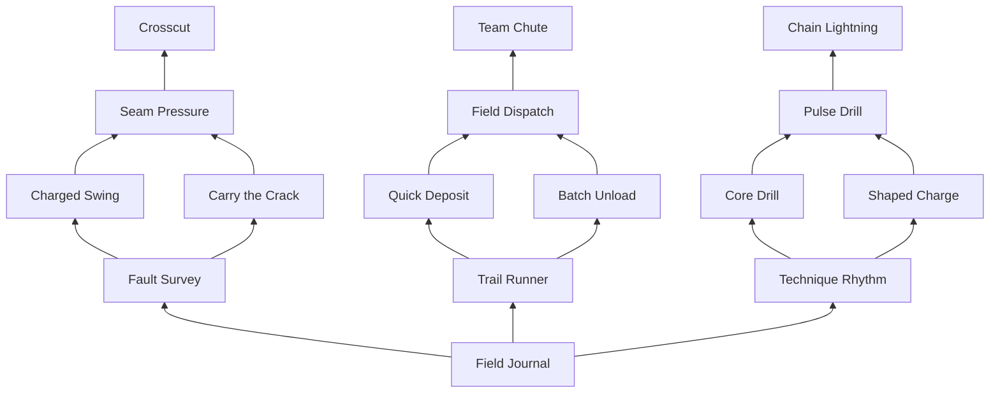

# Phase 5A: player progression, skill tree and rebirth

Status: **recommended design, awaiting approval; nothing here is implemented**. Written 9 November 2026 against commit `e7de4c62d54a460421886f73051857b239d4d04a`. Phase 4B has been reviewed as implementation; earlier gameplay, device, audio and persistence checks remain unverified. This phase changes documentation only. No tests, simulations, Studio edits, assets, data migration, reset, grants or publishing.

## 1. One progression model

Keep credits and equipment as the durable foundation. Earn player XP continuously by removing real egg HP. Spend level-earned points on a connected, three-branch tree that changes how the player works. Rebirth trades current level and the allocated tree for a bounded permanent XP bonus; it never takes tools or inventory.

| System | Responsibility | Acquisition | Rebirth |
| --- | --- | --- | --- |
| Equipment | Each tool's Power, Speed, Capacity, Precision, Yield, Value and Critical upgrades; existing prices and ownership | Existing credits and existing equipment interface | Retain every purchase, including inactive tools |
| Player level | Recognize actual excavation; unlock skill tiers, points and active-technique slots | Contribution XP below; no XP from waiting or buying | Reset current-run XP/level and run milestone entitlement |
| Skill tree | Information, deliberate attacks, logistics and tool techniques; not a second copy of the equipment upgrade list | Points, with prerequisites and build limits | Reset ranks, allocated/unspent points, loadout and temporary effects |
| Rebirth | A limited number of faster subsequent runs | Voluntary level requirement, no currency price | Add permanent XP benefit and increment count; preserve the retained table below |
| Strength / creature buffs | Existing independently acquired permanent capability | Optional training / existing creature collection | Retain; not converted into tree ranks or consumed |

At level 50 the player has **25 points against 39 points of full-tree cost**. Two capstones can be reached with selective rank investment; all three cannot. No extra points from rebirth count, purchases or training. Experimentation is free at the player's room. Completing all branches is deliberately impossible within this initial version, including after ten rebirths.

## 2. Existing code evidence and explicit resolutions

This is a focused source review, not a fresh whole-project audit. Sources are canonical files under `src`; no gameplay module was executed.

| Existing implementation | Conflict / recommended resolution for a later approved implementation |
| --- | --- |
| `DiscoveryCatalog.Level(xp) = floor(sqrt(max(0,xp)/60)) + 1`; `ExcavationService` replicates ResearchXP and ResearchLevel | Replace the level interpretation with the curve below, using the same player-level presentation channel. Do not create a competing displayed level. Existing `xp` is normalized to a whole number by ResearchProfiles. Add an explicit fractional field rather than losing small drill-hit awards. |
| Section breaker gets 2 XP, plus 4 for the deepest layer; each completed contract gets 30 XP | Replace all three XP writes with contribution XP at accepted HP removal. Contract cash, objectives and current final-hit/actor attribution remain as-is. No final-hit player XP remains, including through legacy Break/Collect contracts. |
| `EggRewards` grants 100 XP and `floor(250 * egg.Value)` credits to loaded online contributors at reveal | Under this proposed model, remove only the 100 XP stipend. End results show excavation XP earned during this egg, explicitly **already credited**, not a second completion grant. Preserve credits and their online-at-reveal policy, creature probability/outcomes/claims and receipt guards. This is an explicit proposed change from Phase 4B, not something already applied. |
| `ProgressionRules.SwitchTool`, `toolLevels[id]`, `ownedTools`, active top-level upgrade aliases | Preserve all. Flush active aliases into their tool entry before a respec/rebirth transaction; never zero them as personal upgrades. Purchases remain credit-based, not level-gated retroactively. |
| Strength adds `min(1, strength * 0.0001)` to PowerBonus; an equipped creature adds 0.08, 0.16 or 0.30 | Retain the exact additive formula `1 + strengthBonus + creatureBonus`. Training adds 1 strength per completed 2.5-second cycle, capped at 10,000; retain it as optional, with zero player XP/skill points. No level/tree/rebirth prerequisite requires training. Pace assumptions below assume zero training strength. |
| Effective damage is rounded to integer HP, clamped to remaining HP, and recorded once for materials and whole-egg contribution | Add XP at that same authoritative mutation, after validation/clamping. Skills call that path too. Do not reward client effects, attempts, final-hit identity, overkill, rejected capacity checks or duplicate receipts. |
| MaterialRewards freezes base allocation and one combined Yield-bonus pool; claims retain original unit values | Do not change these rules. Skills that deal actual damage earn the same shares; sale techniques reuse the same inventory/value path. Pending material delivery itself gives no XP. |
| Session-locked ResearchProfiles, memory-only Studio preview, same-server untransferred claims | Extend this profile, not a second save/inventory service. Existing preview grants are not a persistence test or an instruction to grant anything. Keep offline claim limits explicit. No claim of durable verification. |

### Production cutover boundary

The owner has requested a separate one-time full reset of published progress, with no retention or migration. **Recommend activating this new progression schema only with that separately authorized reset**, not converting old XP into new levels or silently resetting profiles in Normalize. Phase 5A does neither. Phase 5B can be reviewed in the original Studio place using its existing memory-only preview behavior; no agent creates test saves or grants resources. Before any later publication, explicitly schedule the one-time reset/activation. Do not publish code that interprets an old profile as a fresh progression profile. Unknown/old schema must fail closed for new progression mutations until the separately approved cutover, not auto-migrate. This is not a recurring reset and does not change the retention rules of ordinary rebirth.

## 3. Exact XP, level and point model

### XP sources and accounting

The initial system has **one player-XP source: server-confirmed effective egg damage**, including eligible skill damage credited to its owner. For a hit removing integer `d` HP:

`earnedXP = (d / 25) * eggXpFactor * rebirthMultiplierAtHit`

| Egg | Existing HP multiplier | Proposed eggXpFactor | Base XP per HP | Example complete shell section, before rebirth |
| --- | ---: | ---: | ---: | --- |
| Ancient Bronze | 1 | 1.00 | 0.040 | 180 HP -> 7.2 XP |
| Gilded Sovereign | 2.6 | 1.15 | 0.046 | 468 HP -> 21.528 XP |
| Volcanic Heart | 6 | 1.30 | 0.052 | 1,080 HP -> 56.16 XP |

HP is already higher on difficult eggs; do not multiply XP by durability a second time. The modest additional factor rewards harder excavation per HP. Each layer uses the same egg factor; deeper layers yield more total XP through their actual HP, not an extra breaker award. Power, precision, crits and techniques influence XP only by removing more real HP. Drill tick frequency, blast target count and tool identity grant no independent XP multiplier.

Example: two players remove 144 and 36 HP from a Bronze shell section. Before rebirth they earn 5.76 and 1.44 XP, totaling 7.2. Either can land the final hit. If a 100-damage attack hits the last 36 HP, only 36 HP earns XP. A blast sums its eligible targets' actual removed HP; it does not earn a separate detonation/break award.

Keep fixed-point accounting at **10,000 subunits per XP**: per HP award 400 / 460 / 520 subunits for Bronze / Gilded / Volcanic, multiplied by rebirth percent / 100. All proposed rebirth percentages produce integer subunits with those rates. Store whole `xp` plus `progression.xpFraction` in 0..9,999; carry into whole XP rather than round each hit. For example R=1, Gilded: 460 * 125 / 100 = 575 subunits per HP. HUD groups receipts at most twice per second, shows tenths of XP and retains hidden fractional credit. Do not round damage or XP again for UI.

Zero XP from section-break callbacks, the completion callback, contracts, selling, collecting, training, idle time, tool purchases, creature delivery and reopening results. Those activities keep their non-XP rewards. No subscription, paid boost or skill-node XP multiplier. This avoids paying for the same damage through hit + break + completion. Existing contract XP removal is intentional, not an accidental omission.

Award only to the actor's legitimately loaded, writable profile in the same non-yielding operation as accepted damage; otherwise reject the action as today. Thus new damage XP requires no offline settlement. Save/receipt behavior must prevent repeated action sequence IDs from granting twice. Rejoining never reconstructs XP by replaying the damage ledger. Record per-egg awarded XP for results, but treat it as a reporting subtotal. If a player rebirths before the egg finishes, label the subtotal as historical XP earned across runs, not their current XP balance; no late grant restores the erased run. At cap, report only XP actually credited, not attempted overflow.

### Curve and milestones

Initial full-system level range: **1..50**. Level 1 starts at 0 XP.

- XP to advance from level L to L+1: `40 + 20*(L-1)` for L=1..49.
- Cumulative XP to reach L: `T(L) = 10*(L-1)*(L+2)`.
- Current level is the highest L <= 50 with `xp + xpFraction/10000 >= T(L)`.
- At level 50, cap run XP at T(50)=25,480 with fraction 0. No hidden overflow bank or automatic rebirth; show MAX and the voluntary choice. Currency/material/creature rewards continue normally.
- Award 1 skill point at **every even level 2..50**. Total entitlement is `floor(L/2)` (0 at L=1), not a replayable level-up event. Available points = entitlement minus valid allocated rank costs. Derive this server-side; do not trust a client-supplied balance.

| Level | Total XP | Total points | Meaningful access (requirements, not free node grants) |
| ---: | ---: | ---: | --- |
| 2 | 40 | 1 | Choose the first branch node; tree opens non-modally from HUD |
| 8 | 700 | 4 | First active-technique slot; Charged Swing, Quick Deposit or Core Drill path |
| 10 | 1,080 | 5 | Second root ranks; stronger utility/build commitment |
| 12 | 1,540 | 6 | Branch forks: Carry the Crack, Batch Unload, Shaped Charge |
| 20 | 4,180 | 10 | Branch merge nodes: Seam Pressure, Field Dispatch, Pulse Drill |
| 25 | 6,480 | 12 | Second active-technique slot; choose two, not a crowded hotbar |
| 30 | 9,280 | 15 | Second merge-node ranks |
| 35 | 12,580 | 17 | Capstones: Crosscut, Team Chute, Chain Lightning |
| 40 | 16,380 | 20 | First rebirth available; can keep progressing instead |
| 45 | 20,680 | 22 | Requirement for second rebirth |
| 50 | 25,480 | 25 | Initial level cap and all 25 points; later rebirth threshold |

Levels never grant another tool for free or lock already-owned equipment. Unlocking a technique for an unowned tool does not grant that tool: disable purchase until owned, explain the existing credit purchase, and do not make that node a cross-branch prerequisite. Active nodes must also occupy a slot; passive nodes do not.

### Pacing targets, not measured playtime

These are arithmetic planning assumptions at R=0 with no training strength, including travel/selling and better equipment over time. They are **not simulations, telemetry, promises or accepted balance**. Effective rates mean XP credited per minute of normal play, not per minute of uninterrupted attacks.

| Stage | XP needed in this segment | Assumed average XP/min | Illustrative segment time | Intended experience |
| --- | ---: | ---: | --- | --- |
| Early, 1 -> 10 | 1,080 | 60..90 | 12..18 minutes | Frequent levels, first points, first technique; learn mining/selling naturally |
| Middle, 10 -> 30 | 8,200 | 120..180 | About 46..68 minutes | Buy equipment, choose a branch fork and active loadout; try another tool |
| Late, 30 -> 40 | 7,100 | 200..300 | About 24..36 minutes | Reach a capstone, refine build and decide whether to rebirth |
| Optional extension, 40 -> 50 | 9,100 | 240..360 | About 25..38 minutes | More points and a second branch commitment before resetting |

First level-up target is roughly 27..40 seconds at the early assumed rate; first rebirth roughly 82..122 minutes across the first three rows. Actual players, egg access, per-tool upgrades, bucket interruptions and multiplayer distribution can differ substantially. Do not slow the first run to manufacture a rebirth benefit. The user's future manual review should establish rates before approving balance changes; preserve these assumptions as assumptions.

## 4. Connected skill tree

Fifteen purchasable nodes, five per branch. A free central **Field Journal** hub connects all three branch roots; it is navigation, not a sixteenth purchased node. Each branch forks and merges. Coordinates below are logical canvas units; y decreases away from the hub. Prerequisites mean **rank >= 1 of every listed node**, not full ranks, unless stated otherwise.

Graph edges are mandatory actual UI connectors. No cross-branch purchase dependency: a player may specialize or mix branches. Branch totals are 13 points each: two root ranks (2), each fork (2+2), two merge ranks (4), capstone (3). A minimum capstone route costs 10; three minimum routes cost 30 > 25. Every listed node/rank resets on rebirth. Rank effects **replace** the prior rank, never add both listed rank values together.

### Common mechanical vocabulary

- `B = floor((tool base Power + purchased Power level * PowerStep) * (1 + min(1,strength*0.0001) + equippedCreature.Power))`. This is the existing pre-precision/pre-critical power, using the relevant tool at action acceptance.
- `D` is B multiplied by existing precision/chain multiplier and then existing critical multiplier (1 or 1.5), before HP rounding/clamping. Preserve radius 0.75, base precision 1.35, purchased Precision step 0.02, chain step 0.05 with max 3, Critical step 0.0125 and max 20. Non-precise multiplier is 1.
- **Ordinary action** means the normal pickaxe hit, drill tick or default explosive detonation; **technique action** has an active damage technique applied. All secondary skill damage is tagged separately and cannot trigger any further skill. Passive triggers described as ordinary do not run on technique actions or secondary damage.
- Secondary damage is based on B, with no extra precision, critical or passive multiplier. It does not roll critical independently. Round once with existing `floor(value+0.5)` then clamp to remaining HP in the common path. Effective damage, materials, hit-time Yield, XP and egg contribution are then recorded normally, once per recipient section.
- Each active node consumes one of the 1/2 slots. Crosscut is a mode of Charged Swing in the same slot, not a third action. C1 modifies technique cooldowns, never tool cadence. Effects are personal unless Team Chute explicitly says otherwise.

### A. Excavation and impact — amber, forged wedges and ceramic seams

| ID / name / position | Prerequisites; level; cost / rank; max rank | Exact effect | Equipment interaction | Required feedback / icon brief | Rebirth |
| --- | --- | --- | --- | --- | --- |
| `impact.fault_survey` / Fault Survey / (-540,-180) | Hub; R1 L2, R2 L10; 1 each; 2 | While aiming at an eligible surface, mark up to 2 / 4 other exposed sections at <=35% HP within 8 / 12 studs of contact. Refresh at most 4 Hz; sort HP fraction then section ID. Visibility rays required; no X-ray. Does not enlarge the existing free aim/HP/precision UI. | No stat bonus; helps select work suited to current Power. | Restrained amber seam brackets with readable low-HP label; icon: inspection lens over a stepped shell crack. Reduced Effects uses brackets only. | Reset both ranks |
| `impact.charged_swing` / Charged Swing / (-680,-360) | Fault Survey; L8; 2; 1 | Pickaxe active: 0.45s authored anticipation, then one strike of 1.60*D. Technique cooldown 8s from accepted start. Normal strike cadence also applies. Invalid contact causes no damage; no frozen movement pose. | Scales existing Pickaxe Power/Precision/Critical once. Speed never shortens the 0.45s technique windup or bypasses normal cadence. | Clear held-back pose, accelerated downswing, one heavier localized accent; icon: weighted pick head with one arcing swing ribbon. No new tool model. | Reset |
| `impact.carry_crack` / Carry the Crack / (-400,-360) | Fault Survey; L12; 2; 1 | An ordinary pickaxe section break by this player arms a 3s transfer. Their next ordinary precise pickaxe hit on a different section within 4 studs of the prior contact, same exposed layer, preserves the previous precision-chain count before advancing it, still capped at 3. One transfer; 6s proc cooldown. Non-precise next hit consumes it with no benefit. | Preserves earned precision, not a free crit or extra Yield; uses purchased Precision normally. No benefit on technique/secondary breaks. | Short bracket connecting old contact to next valid aim; icon: two ceramic chips joined by a carried fissure. | Reset |
| `impact.seam_pressure` / Seam Pressure / (-540,-540) | Charged Swing AND Carry the Crack; R1 L20, R2 L30; 2 each; 2 | Three consecutive ordinary precise pickaxe/drill hits to one section within 4s arm the next ordinary hit on that section for +0.20*B / +0.30*B, within 2s. The third hit only arms; the fourth consumes. Cooldown 8s from arming. Non-precise hit, target loss, switching or expiry clears the sequence. | Add the flat B-based bonus after D, before rounding; no second crit multiplication. Purchased Speed helps reach the sequence, never exceeds validated cadence. Explosives do not build/consume this buff. | Three small seam notches, a brief ready cue, one release accent; icon: three pressure wedges meeting at a seam. | Reset |
| `impact.crosscut` / Crosscut / (-540,-740) | Seam Pressure; L35; 3; 1 | Charged Swing gains a selectable fan mode: same 0.45s windup and shared 8s cooldown; primary 1.20*D, up to 2 distinct secondary sections each 0.35*B. Secondary contact within 4 studs of primary and in a 60-degree surface-plane fan centered toward the player's projected facing. Snapshot before primary damage, same layer. Replaces the 1.60 single hit; never adds to it. | Wider coverage sacrifices primary damage. No extra critical/precision rolls on secondary sections. | Broad but short sideways follow-through, two small contact accents; icon: pick sweep across three ceramic facets. Mode visible before activation. | Reset |

### B. Collection and efficiency — jade, bucket straps and mineral deliveries

| ID / name / position | Prerequisites; level; cost / rank; max rank | Exact effect | Equipment interaction | Required feedback / icon brief | Rebirth |
| --- | --- | --- | --- | --- | --- |
| `collection.trail_runner` / Trail Runner / (0,-180) | Hub; R1 L2, R2 L10; 1 each; 2 | After a positive-value sale, +2 / +4 to walk and sprint speed for 12s, capped at 32 studs/s. Non-stacking, 15s proc cooldown. Any accepted mining/technique or training start ends the buff; no stronger movement during attacks. | No sale-value or capacity increase. Existing 16 walk / 28 sprint become 18/30 or 20/32 while applicable. | Small boot-and-bucket status timer, no camera FOV change; icon: sturdy boot carrying a mineral satchel. | Reset |
| `collection.quick_deposit` / Quick Deposit / (-140,-360) | Trail Runner; L8; 2; 1 | Active: sell the current bucket at an existing eligible sell terminal up to 26 studs away, with unobstructed player-to-terminal ray and a stationary 1.5s channel. 30s cooldown at accepted start. Moving >2 studs, attacking, death, switching, menu or leaving range cancels without sale/refund. | Uses the same full-bucket server sale calculation and selected tool's Value at settlement; never sells pending directly. Normal free sale remains available within existing 13-stud range. | Directed delivery tether and channel ring, actual sale receipt only after server completion; icon: bucket on a short pulley line. | Reset |
| `collection.batch_unload` / Batch Unload / (140,-360) | Trail Runner; L12; 2; 1 | A normal in-person sale can process at most 2 bucket loads: sell actual contents, drain pending once to current capacity, sell that loaded bucket if nonempty, then ordinary final drain. One atomic non-yielding command; no loop over all pending. Does not apply to Quick Deposit, Field Dispatch or Team Chute. | Capacity determines load size; each of the <=2 sales uses existing unit values and Value multiplier/rounding. Existing Sell contract receives credit once per actual sale, not for an empty load. | Receipt splits LOAD 1 / LOAD 2 and remaining pending amount; icon: two mineral buckets at a sorting chute. | Reset |
| `collection.field_dispatch` / Field Dispatch / (0,-540) | Quick Deposit AND Batch Unload; R1 L20, R2 L30; 2 each; 2 | Active: stationary 3s channel sells exactly the current bucket from the current excavation world, no terminal proximity needed. Cooldown 120 / 90s from accepted start. Cancel rules match Quick Deposit except terminal range. No continuous auto-sale; pending drains normally afterward and is not sold again. | Existing Value multiplier at settlement and ownership rules. Full bucket mining is still blocked; player must finish the channel before new mining. | Small courier capsule/tether departure and concise actual sale receipt; icon: sealed bucket with folded courier fins. | Reset |
| `collection.team_chute` / Team Chute / (0,-740) | Field Dispatch; L35; 3; 1 | Active: place one noncolliding delivery chute on a server-validated visible walkable lab surface <=8 studs away, outside egg geometry. Lasts 15s; users within 8 studs and line of sight can sell their own current bucket through the existing sale path. 180s cooldown. Max 1 active per owner, 4 per server; reject over limit without consuming cooldown. No Batch Unload; no automatic sale or caster share. | Everyone keeps their own original material values and Value multiplier. No currency/XP/contribution for providing the chute. Pending fills a bucket through the existing path only. | Compact original workshop chute prop, interact prompt, lifetime dial; icon: two bucket straps feeding a shared jade-rimmed chute. No new inventory. | Reset; remove prop |

### C. Tool techniques — violet and brass, mechanical motion with restrained energy

| ID / name / position | Prerequisites; level; cost / rank; max rank | Exact effect | Equipment interaction | Required feedback / icon brief | Rebirth |
| --- | --- | --- | --- | --- | --- |
| `technique.rhythm` / Technique Rhythm / (540,-180) | Hub; R1 L2, R2 L10; 1 each; 2 | A positive ordinary damage action reduces remaining cooldown of each equipped active **damage** technique by 1 / 2s, at most once per 8s per player. Cumulative reduction on one activation <=25% of its original cooldown; never negative. Drill ticks count as actions but share the 8s gate; one blast counts once. No effect before owning/slotting a damage technique; show that prerequisite benefit plainly. | Never reduces regular tool cooldown, fuse, channel, equipment cost or logistics cooldowns. Useful across Charged Swing and C-branch active techniques. | One small tick on the ability timer; icon: three tool teeth around a brass timing dial. | Reset ranks; cooldown deadlines retained |
| `technique.core_drill` / Core Drill / (400,-360) | Technique Rhythm; L8 and own Drill; 2; 1 | Active: after 2s of uninterrupted valid ordinary drill contact with one section, arm its next 3 ticks for 1.30*D each. Cooldown 12s starts when active request is accepted; contact setup must begin immediately, never stored between uses. Any invalid contact, section destruction, interruption or target change cancels remaining empowered ticks. | Existing drill tick interval and authority unchanged. Benefits continuous focus; no faster remote loop. Empowered ticks are technique actions, not passive-proc triggers. | Contact pressure meter, restrained bit vibration/three tick lights; icon: drill bit inside a compressed mineral ring. | Reset |
| `technique.shaped_charge` / Shaped Charge / (680,-360) | Technique Rhythm; L12 and own Explosive; 2; 1 | Active placement uses radius 3 studs, cap 3, center 1.25*D, linear falloff to 0.50 at edge; existing 0.45s fuse. Technique cooldown 10s plus unchanged tool cooldown. Alternative to ordinary radius 6/cap 7/edge 0.35. Same persistent placement and original-layer detonation rules. | Concentrates existing Explosive Power; purchased Speed applies only to ordinary action cadence, not technique cooldown/fuse. Narrower area is the tradeoff. | Narrow footprint preview, focused inward-then-outward burst; icon: charge with a concave copper liner, no random spikes. | Reset |
| `technique.pulse_drill` / Pulse Drill / (540,-540) | Core Drill AND Shaped Charge; R1 L20, R2 L30 and own Drill; 2 each; 2 | Active: 1.2s spool with no damage, then one validated drill tick of D on primary plus up to 2 secondary sections within 4 studs, each 0.20*B / 0.30*B. Cooldown 10s. Snapshot same exposed layer before damage. Cannot overlap Core Drill; normal drill resumes only while input remains held and valid. | No rate increase; secondary damage does not crit. Uses drill Power and sacrifices setup time for local spread. | Readable spool meter, single contact ring and at most two chips; icon: drill tip sending two concentric pressure arcs. | Reset |
| `technique.chain_lightning` / Chain Lightning / (540,-740) | Pulse Drill; L35; 3; 1 | Active with Pickaxe or Drill only: arm next ordinary contact within 4s, reserving a technique action. Main hit stays D; up to 2 additional distinct sections take 0.35*B then 0.20*B. Each hop <=4 studs from previous contact and <=6 from origin; same original exposed layer, snapshot before damage. Cooldown 15s at acceptance. Unavailable with Explosive equipped: its existing blast already fills the local-area role. Reject such activation without consuming cooldown; show tool compatibility before slotting. | No chance proc, recursive arc or increased creature chance. A missed/expired activation consumes cooldown. Can't overlay another damage technique. | At most two short segmented arcs, 0.18s, no full-screen flash; Reduced Effects uses endpoint sparks. Icon: forked mineral conductor linking three ceramic facets. | Reset |

All prototype parameters are proposed balance, not gameplay-verified. Crosscut's fan is defined on the primary surface tangent plane; degenerate facing projection uses the player's right vector projected into that plane. Snapshot candidate representative contacts are the section's existing validated surface/center reference, not arbitrary concealed mesh points. A later implementation must review how those references map to the current sections without rebuilding the egg.

For Chain Lightning, choose the nearest eligible section other than the primary within 4 studs of contact for hop one, then the nearest distinct section within 4 studs of hop one for hop two, each within 6 studs of origin. Ties use section ID. Both hops must pass the original-layer and visibility rules; all candidates are fixed before any damage. No replacement hop is selected after a target breaks or a capacity gate rejects damage.

### Stacking, eligibility, cancellation and anti-duplication contract

1. Server checks loaded writable profile, ownership, rank, prerequisites, active slot, life, range, round, current exposed layer, bucket/pending restriction, action sequence and all cooldowns before acceptance. Buying/slotting a node never directly applies its effect. No paid or client-authoritative proc.
2. Ordinary damage uses D, then adds Seam Pressure if armed. Active damage replaces the ordinary formula with its table formula; passive damage buffs/transfer/rhythm do not trigger on that technique. No two damage techniques overlap. Core Drill's three empowered ticks are one active technique window; switching technique cancels it without refund.
3. Snapshot **all** root/secondary candidates before applying any HP mutations; sort primary first, then distance (hop distance for lightning), then stable section ID. Deduplicate IDs. Maximum 7 distinct sections per action including ordinary blast candidates and skill secondaries. Only current round, original exposed layer, intact/nonpermanent eligible sections; test visibility using the existing placement/contact visibility rules. Recheck each target before damage, never add newly exposed sections during resolution. Skip an unavailable target without replacing it from a newly exposed layer. Same-layer geometry still needs line of sight; no through-egg shortcuts.
4. Snapshot secondary eligibility for immediate skills at contact; for fuses at detonation, keeping the accepted placement position, normal and original layer even if its original section was destroyed. If the original target is gone, persistent ordinary or shaped explosives may still detonate at their saved position; they never substitute a concealed replacement primary. Lightning is restricted to pickaxe/drill and needs its valid primary contact at acceptance. No eligible sections means visuals only.
5. One HP mutation records one effective-damage amount through the existing authority. Secondary damage cannot trigger passives, another chain, another active or a second grant. Material base/Yield pools and personal creature odds use actual damage normally. No contribution credit for scan, channel, sale, movement or another player's chute use. No duplicate loot because an effect looked like a second hit.
6. Keep existing per-hit capacity gate across the whole sequence: no new mining while bucket is full or pending units exist. Process stable order; once a settlement fills the bucket/creates pending, skip subsequent damage. Earned material shares remain pending, never deleted. Skills cannot exempt the player from this restriction.
7. Accepted action/technique cooldowns are spent even on cancellation, target loss or no-hit outcomes. Invalid requests spend nothing. F, switch/unequip, death, blocking menu and round change cancel armed attacks/channels/counters and pending charges. Ordinary target destruction alone still does not cancel accepted explosives. Chutes are placed world utilities: survive normal tool switching, but despawn on owner death/disconnect, respec, rebirth, round change or 15s expiry. No delayed effects after despawn/cancellation.
8. Cooldowns persist through unequip, respec, death and same-server rejoin; save UTC deadlines for accepted active techniques so reconnecting is not a refill. Rebirth also retains unexpired deadlines. No storing temporary damage/movement buffs as permanent stats. Rhythm tracks actual reduction per activation and its 8s gate; do not reset those guards by changing rank/loadout.
9. Active-slot/loadout changes and respec require the owner in their room, no accepted mining for 10s, no pending action/channel and a writable profile. Respec refunds all **spent points only**, sets ranks to zero, clears temporary counters/buffs and is free with a 60s server cooldown. Unspent points remain within current level entitlement. No credit refund, extra points, active cooldown refill or removal of queued material/creature claims.
10. Presentation budgets are targets: at most 2 secondary accents per technique and 12 concurrently visible technique accents per client, <=0.6s each; prioritize local/nearby actions, drop distant cosmetics first. Chute cap 4 is server-wide. Damage/receipts never depend on rendering. Reduced Motion removes camera/character shake and screen movement; Reduced Effects uses endpoints and ordinary damage numbers. Do not hide success/failure information.

## 5. Rebirth specification

Let R be completed rebirths, initially 0. Recommend **at most 10 rebirths** in this initial system; the button is disabled at R=10 with the cap explained. Never offer a reset with no additional benefit.

- Required level for next rebirth: `min(50, 40 + 5*R)`. No credits, materials, creature sacrifice, paid bypass, time gate or mandatory egg final hit.
- Permanent XP multiplier: `M(R) = 1 + 0.25*min(R,4) + 0.10*max(0,min(R,10)-4)`.
- Thus +25 percentage points per rebirth for the first four, then +10 points for six more; max **2.60x**. These are additive percentage-point increments, not repeated multiplication by 1.25. No permanent damage/loot/creature-chance bonus from rebirth.
- Available only voluntarily in the player's room, after 10s without accepted mining and no active/pending technique, while the profile is writable. Confirm current level/XP/points, reset fields, retained inventory and the exact before/after XP multiplier. The server recomputes everything on confirmation; no default-selected destructive action.

| Rebirth performed | Requirement with prior R | Raw run XP threshold | M before -> after | Base-equivalent excavation XP needed to reach threshold before reset | Example: 100 base XP earns after |
| --- | --- | ---: | --- | ---: | ---: |
| First (0 -> 1) | L40 | 16,380 | 1.00 -> 1.25 | 16,380 | 125 XP |
| Second (1 -> 2) | L45 | 20,680 | 1.25 -> 1.50 | 20,680 / 1.25 = 16,544 | 150 XP |
| Third (2 -> 3) | L50 | 25,480 | 1.50 -> 1.75 | 25,480 / 1.50 = 16,986.666... | 175 XP |
| Tenth (9 -> 10) | L50 | 25,480 | 2.50 -> 2.60 | 25,480 / 2.50 = 10,192 | 260 XP |

The requirement rises early, so the next entire rebirth cycle is not promised to be shorter than the first. Rebuilding the same level is faster: L20 needs 4,180 base-equivalent XP at R0, 3,344 at R1, about 2,786.67 at R2, about 2,388.57 at R3 and about 1,607.69 at R10. Retained equipment also changes real rate; these are arithmetic examples, not playtime measurements. At any qualifying level the player can keep their current tree instead of rebirthing. Level 50 remains available at R0; no rebirth-only worlds or skill tiers in this proposal.

### Exact reset/retain contract

Proposed new fields live under one versioned `progression` object in the existing profile. Names here are schema requirements for later implementation, not fields created in this phase. Derived values should not be stored redundantly.

| Field / state | Rebirth operation |
| --- | --- |
| Existing `xp`; new `progression.xpFraction` | Set to 0; displayed ResearchLevel becomes 1 using new curve |
| `progression.skillRanks` | Clear every node rank; no permanent skill-rank carryover |
| Skill-point entitlement / spent / available (derived) | Become 0 at L1; previous unspent points do not carry. Re-earn at even levels of the new run. No extra starting point per rebirth |
| `progression.activeSlots` and earned run milestone access (derived from level) | Clear selected techniques; slots locked until L8/L25 again; prior illustrations/discovered descriptions may stay visible but confer no effect |
| Temporary seam/precision transfer charges, channel state, skill movement effects, field prop, armed abilities | Cancel/clear; never copy into permanent buffs. Existing tool action cooldown still applies |
| `progression.rebirths` | Increment by exactly 1 up to 10; permanent multiplier derived from it |
| `progression.runId` / `progression.revision` | Increment; reject stale purchase/respec/rebirth intents from prior run/revision |
| `progression.techniqueReadyAt`, rhythm reduction guards, respec deadline | Retain unexpired cooldowns; no refill exploit through rebirth |
| `ownedTools`, `toolLevels`, active upgrade aliases, `toolId`, `drillTrialUsed` | Retain all; selecting another tool never erases investment; rebirth does not refresh a trial |
| `cash`, `income`, `contents`, `materialValue`, `pendingMaterials`, `samples`, `relics` | Retain unchanged. No implicit sale, currency reset, capacity amnesty or averaging of claim values |
| `creatures`, `equippedCreature`, `discoveries`, `displaySlots`, `eggRewardReceipts` | Retain; pending same-server creature/material claims remain eligible for normal transfer |
| `strength` and other separately acquired permanent buffs | Retain unchanged; no skill effect is written into strength/creature power |
| `roomTheme`, `roomThemes`, other owned cosmetics/decorations, settings | Retain unchanged |
| `tutorial`, `introStage`, `contract`, `contractProgress` | Retain; no replay/grant of tutorial or contract milestones through rebirth |
| Current server egg contribution, section contribution and frozen egg settlements | Retain, even if the player rebirths mid-egg. New damage uses new run XP multiplier; prior damage/claims are not rerolled, multiplied again or reassigned |
| Future achievements, trophies, unlocked worlds, permanent acquisitions | Retain explicitly when those fields exist; none are implemented by this specification |
| `profileVersion`, `economyVersion`, progression schema version, session lock | Rebirth does not act as a schema migration or a new profile; retain service-managed metadata |

A rebirth is one server-authoritative, non-yielding in-memory profile transaction after validations, then uses the existing save/session-lock path. Do not claim successful durable persistence until a real save acknowledgment; a transient save failure must not trigger a second grant. Persist the new run/rebirth count together with the resets, use a request ID/revision guard and serialize mutations with the existing profile owner. UI waits for the server response and labels saving/failure. Restoring after a crash remains subject to the actual save system, not a documentation guarantee.

## 6. Dedicated tree screen and art specification

The existing HUD/menus remain **functional interim UI, not final visual quality**. This specification does not approve their art, produce a concept board or fulfill final illustrated equipment/upgrade screens. The tree is a dedicated view reached from a compact level/XP/points button and MORE; opening it cancels mining. No auto-open on every level, respawn or join.

### Layout and navigation

- Logical canvas bounds x=-900..900, y=-900..120; hub at (0,0), nodes at table coordinates. Three illustrated branch headers sit above their capstones. Connectors route through fork/merge junctions with arrows pointing toward advancement; node dependencies must match the server data, not separate hard-coded art.
- Desktop >=900px safe width: 64px top status strip, canvas taking remaining width minus a 320..380px selected-node panel; 16px gutters. Panel contains original illustrated icon, name/branch, current/max rank, exact current and next effects, prerequisites/level, point cost, available points, equipped status and one server-confirmed purchase action. Disabled action states explain the blocking requirement. Close and Recenter remain visible.
- Narrow/portrait: top strip <=88px with level, XP and points; canvas remains the main view. Selected-node bottom sheet uses 38% height, expandable to 70% for details and collapsible to a 56px summary. Text scrolls within the sheet only. It is never replaced by a list of upgrade buttons. Keep node navigation visible behind the sheet; recenter uses the unobscured rectangle. Landscape mobile uses a compact 280px side panel where space permits.
- Mouse: drag empty canvas; wheel zoom anchored under cursor. Touch: one-finger drag canvas, two-finger pinch around midpoint. Drag >8px suppresses node activation; tapping a node selects, never purchases. Zoom range 0.55..1.40; initial fit clamped to range, so phones pan rather than shrinking all text into illegibility. Recenter focuses hub plus first branches at usable scale; branch tabs focus their cluster. Clamp panning so at least one node/edge remains reachable. Plus/minus buttons provide an alternative to pinch/wheel.
- Nodes are 88 logical units, at minimum zoom a 48.4px target; control touch targets >=48px. Rank badges and short node labels stay readable (>=14px) instead of scaling into tiny text; hide distant labels at overview zoom in favor of selected label, never hide rank/state. No screen-edge overlap with Roblox chrome/safe areas. These are layout targets, not measured device approval.
- Keyboard/gamepad: directional traversal follows graph neighbors, confirm selects, distinct action purchases, Back closes panel/screen; selected node is brought into view. Zoom buttons and Recenter are focusable. No mouse-only hover requirement. Inspector shows scroll position/focus, with no hidden purchase target.
- Show level, current-level XP / next-level requirement, available points and rebirth count/multiplier. At cap show MAX; pending data shows synchronizing, not zero placeholders. Rebirth gets a separate explicit confirmation pane with the reset/retain summary, not a click on the tree hub.

### Node and feedback states

| State | Appearance and behavior |
| --- | --- |
| Locked | Desaturated illustrated face with a physical clasp overlay, broken/etched connector and written unmet prerequisite/level. Still selectable for planning |
| Available, rank 0 | Clean branch-colored rim, empty rank sockets, solid available path; affordable cost shown. If points are insufficient, show cost and reason without pretending the node is locked by a prerequisite |
| Partially upgraded | Filled sockets for owned ranks, remaining socket outlined; selected panel shows current/next exact effects and level requirement |
| Completed | Distinct engraved rim and all sockets filled, completed text; no fake purchase button. Slotted active nodes have a separate numbered loadout ribbon |
| Not shipped in first subset | Explicit PLANNED ribbon, effect visible for planning, no purchase or active-slot assignment; do not confuse missing implementation with a level lock |

Colors supplement shapes/text; availability must not rely on red/green. Successful unlock: one 0.25s rim fill and short connector trace, concise skill name/points receipt after server confirmation. No screen shake, modal celebration or continuous node pulses. Reduced Motion uses an immediate state change and static receipt; Reduced Effects removes trace particles. No sound is invented or claimed produced; later approved delivery needs one permitted, brief workshop unlock click/chime respecting current volume settings.

### Actual required assets and available capabilities

Required final tree art is original polished, playful excavation fantasy: readable forged metal, ceramic, jade mineral and stitched straps, bold silhouettes, selective highlights and uncluttered backgrounds. No emoji, generic default glyphs, rejected weapon concepts, copied external game icons, or recolored rectangles presented as finished art.

| Art group | Deliverable target |
| --- | --- |
| 15 unique node icons | One illustration per stable ID using the motif in the node tables; 512x512 editable master and 256x256 transparent PNG runtime export, readable at 48px. Same illustration used for inspector and ability slot; ranks use overlays, not recolors masquerading as new art |
| Hub + 3 branch emblems + rebirth emblem | 5 original illustrations; 512 masters / 256 exports. Rebirth: a renewed journal clasp around an excavation spiral, not a new currency symbol |
| State and loadout kit | 4 sculpted node-frame states, clasp overlay, rank socket empty/filled, focus outline and 2 slot ribbons; reusable transparent assets. Main panel frame and selected-node frame designed as two scalable border assets. Connectors are code-drawn paths with original junction/end-cap art |
| Navigation / status kit | 6 designed control marks (close, recenter, zoom in/out, back, confirm) plus 3 status emblems (XP journal mark, skill-point token, active-technique slot); consistent stroke/material language, accessible text labels. Skill points are progression entitlement, not a purchasable currency |
| Background and typography | One low-contrast 1024x1024 workshop-map backdrop; use the project's existing font family with explicit 14/16/20/28 size roles rather than requiring a font install. Decoration must not fight the node graph |
| Later ability implementation | 3 small prop needs (deposit tether endpoint, field courier capsule, team chute), controlled swing/spool poses, two endpoint spark textures and one narrow arc strip. Reuse existing tool/shell models and current impact materials where suitable. No Blender presentation scenes or model production in this phase |

These are **targets**, not created files or measured memory/performance budgets. Initial subset needs its nine node icons, common UI kit and branch/hub art; the six unshipped nodes can remain clearly labeled planned silhouettes during functional review, never called final art. Final full-tree visual approval requires all fifteen illustrations.

Available capabilities inspected without executing generation/upload: an image-generation tool is exposed for raster artwork; it can be used in a separately approved production phase, but does not guarantee coherent finished icons or layered editable illustration sources. Original SVG/vector source can be authored as repository files; raster export capability must be confirmed for the selected existing workflow. Do not promise a layered PSD/Blender file from a generated bitmap. Preserve the bitmap master, provenance/prompt if used, any authored vector layers and final exports honestly.

The current Studio MCP exposes `upload_image` (HTTP image URLs -> Roblox asset IDs), `store_image` (local reference for other tools, **not an asset upload**) and `insert_asset`. No upload was attempted, so owner/group permissions, local HTTP serving/reachability, moderation outcome and asset access in the experience are **unverified dependencies**, not completed capabilities. A reliable generic local-file image upload and approved layered illustration editor connection have not been established. No Blender/BlendRelay tool is exposed here and no component needs launching for this written phase. Do not install a workaround; if upload cannot be completed later, request only the required owner upload/permission action and retain source files.

Future production path after approval: author the agreed icon kit -> preserve editable sources -> export PNGs -> review readability in the original Studio UI -> use the supported upload route if access is established -> record returned IDs/owner/moderation status -> assign approved images in the original place -> source/property readback -> user manual device/visual review. Proposed repository locations: `assets/ui/progression/source/`, `exports/`, `manifest.json`. Manifest maps stable node/control IDs to source/export hashes, pixel dimensions, padding, nine-slice border settings where relevant, uploaded IDs, owner and permission dependency. No invented IDs, bulk installs, unapproved uploads or duplicate place. Git retains source and manifest; native backups retain Studio assignments, not hosted asset bytes.

## 7. First implementation subset and later integration

Recommend Phase 5B as a bounded vertical slice, after explicit approval:

1. Contribution XP service integrated at the existing effective-damage mutation; remove old section/contract/completion XP writes together so there is never a double-paying intermediate release. Keep all unrelated cash/material/creature rules. Surface per-egg already-credited XP in results.
2. Initial **release gate at level 20** using the same full curve, 10 points maximum, run XP capped at T(20)=4,180 with fraction 0 and no overflow bank. This is a temporary content gate, not a second level system. Opening levels 21..50 and rebirth requires the remaining-node delivery below; show that boundary honestly. Lifting the gate resumes from saved XP, without restoring unearned overflow. The 50-level design is not claimed shipped by this subset.
3. Build the actual pannable connected canvas and point/loadout/respec authority. Implement **A1-A3, B1-B3 and C1-C3** (nine nodes), including all proposed ranks available through L20. Their full cost is 18 versus 10 available points, so builds already differ. One active slot. Remaining six nodes visible as planned, non-purchasable. Only already-owned tools can use their techniques.
4. Deliver nine illustrations/common kit as real UI assets if capabilities/permissions permit; otherwise report art incomplete, not final visual acceptance. Preserve current tool models. Rebirth schema/confirmation contract is documented but **rebirth action remains disabled**, with no reset or permanent multiplier granted in this subset.
5. Manual checkpoint in original place: contribution XP under all tools, level/point accounting, independent equipment retention, invalid purchases, respec, cancellation, simultaneous material settlement, responsive canvas, source/save limitations. Agent does not run these checks.

After that review, a separately authorized continuation adds A4-A5/B4-B5/C4-C5, two-slot loadouts, level 50 and the exact rebirth transaction together. Do not enable repeated resets against an incomplete tree. These are sequencing recommendations, not authorization to implement either stage now. Full illustrated equipment screens remain a separate art deliverable; completing the tree alone does not complete them.

### Integration seams to reserve, not build now

- Versioned player-progression module owns XP curve, rank validation, costs, active loadout and rebirth; shared read-only node catalog owns IDs/positions/descriptions. Existing ExcavationService remains the accepted damage/ownership authority. No parallel combat or inventory system; client requests intent and renders confirmed state.
- Reward delivery uses typed payloads behind the existing EggRewards settlement identity. Future `Creature` -> `HatchableEgg` payload change must preserve one-roll and once-only delivery semantics; do not change probabilities or issue both rewards now.
- Home incubators/care may consume future owned egg entries through the existing profile lock/transaction boundary; reserve IDs and payload version only. No hatch timers, care loops or room rework here.
- New tools can declare compatible technique IDs; new egg/world definitions can supply an explicit xpFactor. Do not infer it from price, rarity text or drop chance. New world unlocks remain retained across rebirth; no level 200 requirement is decided here.
- Future achievements/customization can listen to authoritative level/skill/rebirth/completion events with stable IDs, separate from the resettable skill ranks. No achievement, trophy currency or cosmetic buff is awarded now.
- Public redeem codes and the restricted 100,000,000-credit tester code remain roadmap notes; no strings, tester IDs, grants or redemption service in this phase. The one-time full published-progress reset remains a separately authorized operation. User-reported manual publication of prior work is acknowledged; do not assume the live experience is older.

## 8. Approval needed and evidence limits

One recommended design is presented, not competing alternatives. Material approval points are: (1) the replacement of all legacy player-XP payouts with damage XP, level/point curve and free respec; (2) the 15-node mechanics/build budget and bounded ten-rebirth reset/retention contract; (3) the staged nine-node/L20 Phase 5B scope, with full rebirth only after the remaining tree, and separate production reset/activation timing. Numerical tuning is provisional until the user's manual review; no additional broad planning exercise is required to start the approved subset.

No runtime scripts, Studio assets, saves or published data were changed. The original place remains the only target. No new place backup was needed because this is documentation-only; the starting Git commit identifies the source inspected. No tests, Play/Run, simulations, automated gameplay, generated boards, GIFs/videos, installations or publishing. Source inspection and arithmetic examples do not establish gameplay balance, mobile performance or persistence. Stop for approval before Phase 5B.
