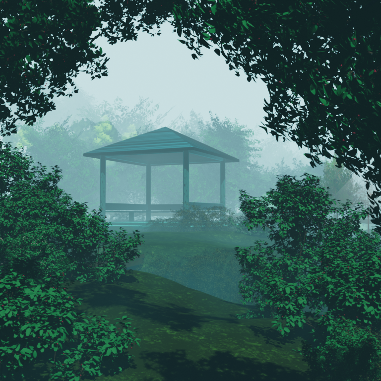
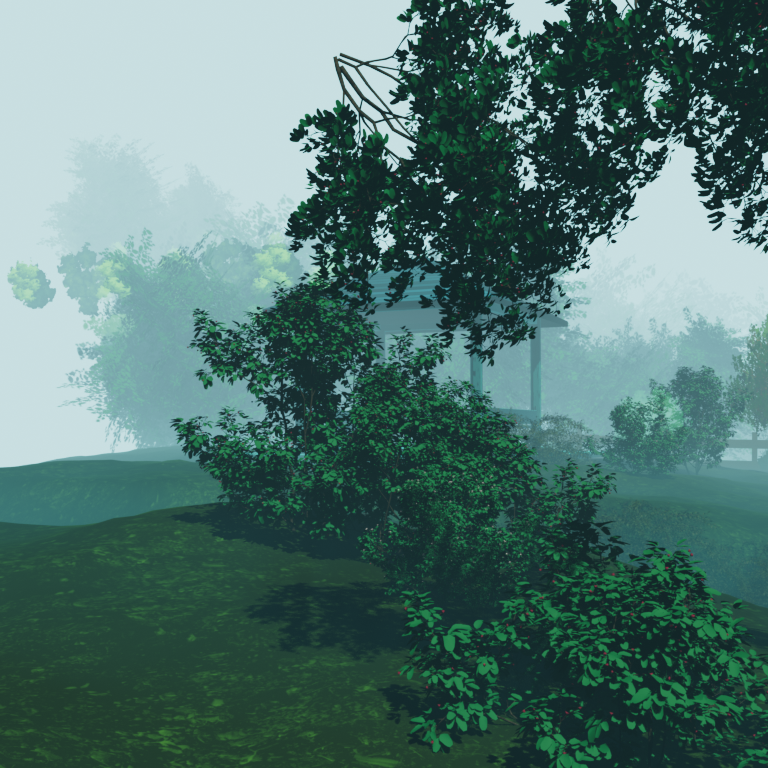
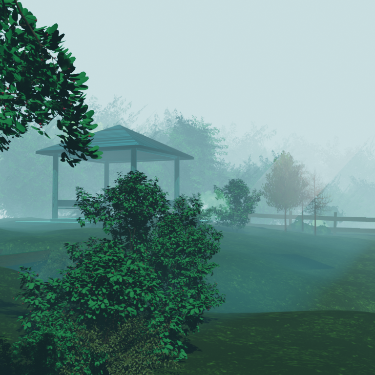
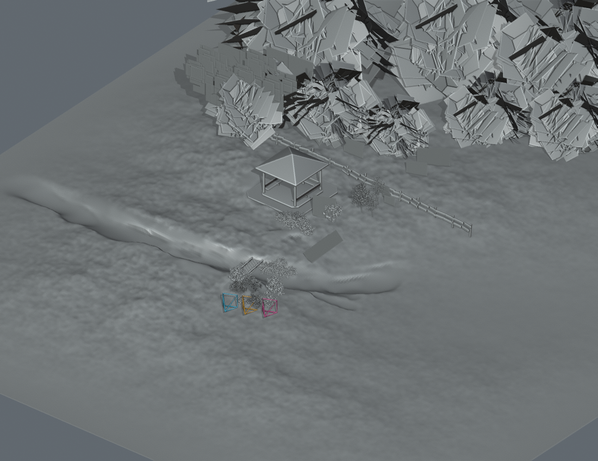

# Exact Blendkit source-scene inspection

Source-only checkpoint. Original Roblox place 94763223427049 remains at published v162; no Studio operation, Play, world change, import, upload, publication or player-data operation occurred.

## Exact source and license

- [Stylized Anime Foggy Gazebo Nature Scene](https://www.blendkit.com/asset-gallery-detail/dc5632f8-2513-4b53-9f5f-096fd493e261/), **sivix gamer**.
- Asset base ID `dc5632f8-2513-4b53-9f5f-096fd493e261`; downloaded version ID `4ad27ae1-25e2-4f34-92cc-32341200fea0`, version 1, authored in Blender 5.0.1.
- Free download, **Royalty Free**, not CC0. [License](https://www.blendkit.com/docs/licenses/) and [FAQ](https://www.blendkit.com/docs/licenses/licensing-faq/) permit rendered outputs and higher-level works, but not redistribution as an asset pack/scene; games must not expose readily extractable source assets. Raw scene, packed images and private service responses are excluded from Git.
- Full source: **728,214,055 bytes**. SHA-256 `6d8e7173907018d989252e4d8ee7101dfee0ebe021fba1456bd245cfaa81c1bd`.
- Private original: `Backups/BlendkitInspection/original-scene.blend`; separate working copy: `inspection-copy.blend`. Original is never saved over. Embedded script auto-execution disabled. No scripts were present in the file.
- Some packed image paths identify **Maxtree Plant Models Vol 6**; others identify ForestGround02 and Wood063. The [Maxtree Vol 6 product](https://maxtree.org/products/plant-models-vol-6/) is a separately licensed commercial collection. The Blendkit listing license was checked, but the uploader's permissions for these constituent sources have not independently been established. No accusation is inferred from filenames. Review before any production redistribution/import; no extracted maps are published here.

## Blender and rendering setup

The owner authorized the latest official stable release, not an asset-version-matched older release. On 2026-11-10, the [official download page](https://www.blender.org/download/) listed **5.2.3 LTS** as stable and 5.3 as Beta. Downloaded official Windows x64 portable ZIP alongside existing 4.5.15; no global preferences, add-ons or file associations changed.

- Actual running version: **Blender 5.2.3 LTS**, build `e13b728c6880`.
- Official ZIP SHA-256 verified: `723f08a4401502561eb763cdeacf8745b31e5f3f154d287d3830d97cf75dc2fb`.
- Existing 4.5.15 was insufficient for faithful rendering: it substituted Standard for ACES 1.3 and warned about a newer file. No beauty outputs from that version are delivered.
- Native scene is **EEVEE**, despite the listing mentioning both Cycles and Eevee. Shader to RGB nodes are essential; switching to Cycles is not a faithful substitution.
- Original camera `Camera.014`, 50 mm perspective, frame 104, 1080 x 1080 source resolution. Preview output 768 x 768, 32 EEVEE render samples; lighting, materials, world, fog, compositor and geometry left intact for beauty views.
- **ACES 1.3**, look None, exposure **0.7048463821**, gamma 1 retained. One white Sun, strength 3, plus node-based World illumination.
- Offset cameras translate horizontally **-3 and +3 scene units (not scaled to Roblox)**, keeping the original height **2.258803** and original direction/lens. No re-aiming or restaging to hide flaws.
- The solid overview uses Workbench studio shading, no compositor, and hides only the fog enclosure to reveal geometry. Renderable camera frustums are diagnostic annotations: original orange, left cyan, right pink. It is a solid viewport-style export, not a beauty render or screenshot of Roblox.

## Observed construction and dependencies

The website's polygon/object count of 1 is not representative of the download.

- **245 objects**, including **240 mesh objects**, 3 curve objects, one camera and one Sun.
- **67 unique meshes**, **10,713,518 raw faces**; **10,713,691 faces counted across mesh objects**, before evaluating modifiers. These are not runtime triangle/performance measurements.
- **186 one-face quad objects**: foliage cards distributed in space, in addition to dense modeled shrubs, branches, gazebo and terrain. This is neither a single painted plane nor uniformly full 3D foliage.
- **27 image datablocks, all packed**, 30 materials. Original absolute image paths are unavailable locally, but their packed bytes are present; this is not a missing-texture finding.
- Image maps include foliage, leaf/opacity, bark, forest-ground color/normal/roughness/displacement and wood maps. Materials also use Noise, Voronoi, Gradient, Brick, color ramps, Fresnel, emission and Shader to RGB.
- Volumetric enclosure `Plane.300` uses a mapped gradient/ramp driving Principled Volume density. The compositor also uses **Render Layers Mist -> Color Ramp -> Alpha Over** with a pale cyan foreground. Atmospheric depth is therefore substantially renderer/compositor dependent.
- Foliage cards combine images, transparency and procedural masks/tints. Their planes and silhouette presentation can become evident from other angles. The World uses a Light Path camera-ray distinction, and several shaders use Fresnel/view-dependent inputs.
- Geometry-node groups include Array, Randomize Transforms and Proxy; mesh modifiers include Decimate, Bevel, Solidify and Weighted Normal. They require evaluation/baking before interchange.
- No unresolved external `bpy.data.libraries`, embedded Text scripts, object drivers or camera constraints were reported in the 5.2 inspection. Packed textures and local node groups were available without installing third-party add-ons. The 4.5 load emitted an old Blender 5.0 essentials-library warning; no corresponding unresolved-library warning appeared in the 5.2.3 rendering run.

## Transfer assessment

Do not directly import this 10.7-million-face authoring scene as Roblox scenery. Terrain, gazebo and selected plant geometry can be exported after optimization; source topology, textures and license treatment need review. Material graphs, Shader to RGB, Mist compositing, ACES display response, volumetric enclosure and geometry-node workflows do not transfer as Blender features.

A plausible later hybrid would retain simplified nearby terrain, trunks, shrubs and architecture for parallax, while baking distant canopy/background layers. That could preserve more of the painted atmospheric appearance than a raw mesh import, but a single flat background would not preserve near-object parallax across the dome. Baking distance haze into nearby geometry would also conflict with changing viewpoints and the existing laboratory lighting. No hybrid, bake or Roblox implementation was created here; owner selection follows the actual preview review.

## Actual exported beauty views

| Original intended camera | 3 units left, same height/direction | 3 units right, same height/direction |
|---|---|---|
|  |  |  |

These are newly rendered pixels from the downloaded scene, not the website thumbnail. The privately downloaded listing image was used only for visual comparison and is not redistributed here.

The original-camera render closely reproduces the advertised framing, teal mist, dark canopy and gazebo. This is a visual comparison, not pixel equivalence; output resolution/sampling and Blender minor version differ.

The left offset exposes substantial foreground occlusion, floating-looking distant foliage clusters, a conspicuous exposed branch structure and open terrain outside the intended framing. Real parallax exists, but the original canopy composition does not survive a modest sideways move unchanged. The scene should not be treated as a ready-to-use multi-view environment for the dome.

The right offset reveals more of the gazebo and fence but loses the canopy arch and exposes broad open ground. The foreground shrub shifts prominently across the view. The images establish useful local depth, not convincing views throughout our much larger dome or around the full environment.

## Solid geometry overview

Orange: original camera. Cyan: left offset. Pink: right offset. The foliage planes appear as opaque cards in solid shading; this is intentional diagnostic visibility, not a failed beauty material. The scene includes a large terrain surface, but most detailed staging is concentrated around the chosen view. The overview crops some outer canopy at the top and ground edges; it is not a complete orthographic asset inventory.

## Conclusion and remaining uncertainty

- **Advertised appearance:** closely reproduced from the original camera with native materials, fog and compositing retained.
- **Multiple dome viewpoints:** unsuitable as a direct drop-in. Side offsets show occlusion and camera-composition limitations despite real parallax.
- **Transferable:** optimized terrain/architecture/selected plants, permitted baked maps and carefully placed cards. Raw geometry is far too dense for an unexamined game import.
- **Reconstruct/bake:** toon material response, procedural texture details, geometry-node output, foliage treatment, distance color and fog/compositing. Preserve near depth rather than flattening the whole scene.
- **Hybrid potential:** promising for distant atmospheric forest behind genuine near geometry, conditional on licensing and a later deliberately scoped parallax/composition check. No claim of preserving every view, original dynamic lighting or identical Roblox appearance.
- **Uncertain:** constituent asset rights, wide-angle/backside views, exact final Roblox shading, suitable geometry reduction and mobile cost. No Roblox integration or performance work was performed.

The process emitted Blender API deprecation warnings and an unspecified `Unable to delete file` message at shutdown. All four render saves completed and each PNG decoded successfully and was visually inspected. The source and working copy still hash identically to the downloaded original. No missing packed texture was observed; the warning is retained rather than described as a completely clean process.

Only this README, the four renders, summary/camera metadata and our own inspection/export scripts are redistributed. Private raw source, library metadata dumps, signed download responses, original thumbnail and texture files remain under ignored `Backups/BlendkitInspection/`.

Stop here for owner selection. No Studio changes, Play session, publishing or environment implementation.
