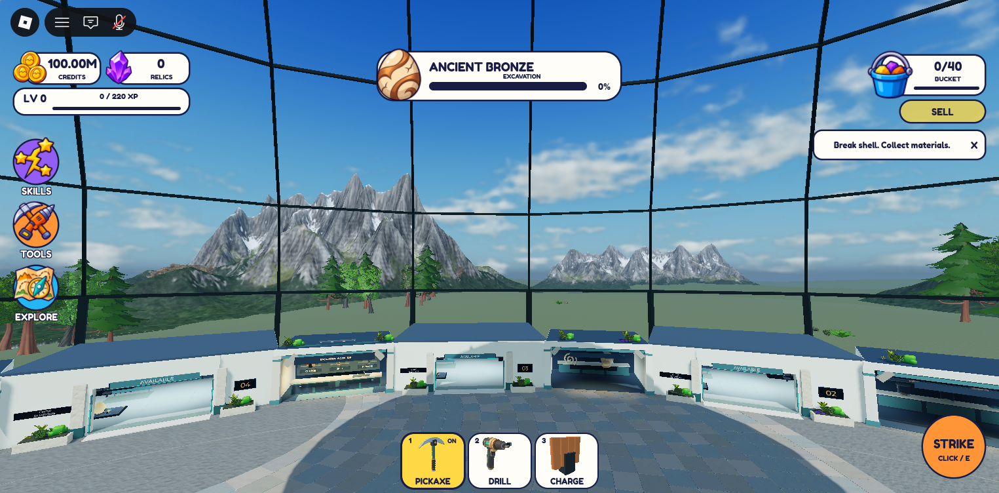

Owner continuation: the v180 direction received positive feedback. [v182 integration and complete layout/high-view evidence](../exterior-integration/REVIEW.md) is now current. Existing mountains/vegetation were retained and integrated; the new checkpoint has an explicit unresolved runtime far-ridge visibility gap.

# Exterior composition and legacy cleanup — v180

Published to original place **94763223427049** at **2026-11-10 16:44:15 UTC**, branch `planning/development-foundation`. Studio log confirms `publishType=1`, “Published new changes” and “Add publish notes to v180”. The prior native download was a cloud save, not the publication evidence. Started from clean commit `378fc85545cd848f79aa8a31ca79623e3633ad5d` / v177. Implementation and captured evidence: [95804375129062de0b3b1a2284675033f8522b26](https://github.com/alrimii/vesper-excavation/commit/95804375129062de0b3b1a2284675033f8522b26). A following documentation-only commit records this identifier; it does not change the frozen scene.

The owner confirmed successful published joining before this milestone. Joining is closed; no equipment/profile changes or new joining investigation. The owner's `exterior-direction.png` was inspected as a composition reference only. Current dome, interior, crown, hoist, egg, HUD and camera implementation remain preserved. No architecture from the reference was copied. This is a frozen implementation checkpoint, not owner visual approval or an exact reference match.

## Actual before/after evidence

All comparison images are **Studio Edit-mode screenshots**, at matching position/target, FOV 70, 1525×752. They are not runtime proof or Blender renders.

| View | Camera → target | Before | After |
| --- | --- | --- | --- |
| Normal central floor height | `(103,7,70)` → `(930,150,625)` | [Before](before-central-edit.png) | [After](after-central-edit.png) |
| Elevated excavation walkway view | `(56,64,35)` → `(930,150,625)` | [Before](before-walkway-edit.png) | [After](after-walkway-edit.png) |
| Opposite floor-height view | `(-115,7,-70)` → `(-900,140,-600)` | [Before](before-west-edit.png) | [After](after-west-edit.png) |

One prepared **57.6-second capture-only Play session**, 16:41:55–16:42:53 UTC. Camera placement succeeded; four actual client screenshots were taken. No navigation, mining, grants, purchases, server-round changes, device switching or gameplay testing. The visible 100M preview credits are the pre-existing memory-only Studio behavior, not a grant or production balance change.

| Runtime viewpoint | Actual evidence |
| --- | --- |
| Central normal height | [central-runtime.png](central-runtime.png) |
| Elevated walkway: open apron, forest groups, rocky range and valley | [walkway-valley-runtime.png](walkway-valley-runtime.png) |
| Opposite direction | [west-runtime.png](west-runtime.png) |
| Room-front approach, showing the real occlusion limitation | [north-room-runtime.png](north-room-runtime.png) |

## Keep / remove / replace

| Disposition | Exact active objects / source paths |
| --- | --- |
| Removed after native backup | All old children of `Workspace.VesperLab.DecorativeExterior`: `ScenicBase`; `WaterfallBasin2` (stacked rocks and straight water); `LandscapeGroup5`, `6`, `7`, `8`, `9`; five primitive mountain placements named `Mountain1` (2), `Mountain2` (2), `Mountain3` (1); `FoggyGazeboExterior` (old source scene, shelf/gazebo/placements); `AtmosphericLayers` (1,152 continuous-ridge wedges and 60 repeated canopy meshes). No retired placement was moved elsewhere in Workspace. |
| Generator paths retired | `LivingLabBuilder.Exterior`, `LivingLabArtBuilder.Exterior`, `ValleySectorBuilder.Build`, `FoggyGazeboBuilder.Build`, `DomeLandscapeBuilder.Build`. Their obsolete exterior bodies are removed from active source; entry points now refuse execution with a retirement message. The last combined dome/landscape recipe cannot rebuild its old ridge or alter the current crown. Native modules in `ServerStorage.VesperTools` match the canonical files. Historical source remains in Git/private recovery. |
| Retained / reused | `ServerStorage.LivingLabArtAssets`: Quaternius broadleaf trees, twisted trees, conifers, ferns, grasses, shrubs and rocks; KayKit shrubs. 102 trees in nine irregular groups and 88 low plants/rocks in eleven pockets. Large-tree centers are about 690–1,412 studs from the lab center, with a broad open gap outside the dome. All original template libraries remain available. |
| Retained privately, undisplayed | `FoggyGazeboAssets`, `ValleySectorAssets`, older `LivingLabAssets` and their source records. Existing unresolved constituent/Maxtree rights are unchanged. This task does not claim their clearance. |
| New active scenery | `ContinuousLowGround` (64 mesh tiles), `SeparatedRockMassifs` (5), `RockyFoothills` (14), `IrregularForestIslands` (102), `SparseMeadowPockets` (88), `ValleyMist` (2 noncolliding hosts/beams). [Native inventory](scene-inventory.json). |

## Sources, rendering and preservation

Actual downloaded **Innerscene Mountain Range**, **Poly Haven Mountainside** and **Rock Face 02**, all CC0, were adapted in Blender 5.2.3 LTS. [Exact source/license links, uploaded IDs, creator metadata, download hashes, preparation and recovery](../../../assets/environment/exterior-composition/README.md). The private original sources remain unchanged. The actual mountain color texture was assigned explicitly after the importer selected the wrong merged material.

Five rotated/scaled source ranges create unequal peaks, lower openings and a farther valley range. Fourteen partially buried source cliff/buttress meshes add rocky foothills. Continuous low relief ground replaces disconnected shelves; middle forest groups have differing spacing, rotation, density and height. No authored primitive mountain set, terrain mountain sculpt, scenery billboard, cutout panel or new accessible outdoor world. Opaque textured mesh geometry provides depth through the existing matte glazing; localized mist is two faint low beams, not an enclosing screen.

Active exterior: **1,527 → 275 BaseParts**, including 273 meshes; all exterior collision/query/touch flags are off. Three prepared unique rock assets: **343,806 → 27,998 triangles**, source color maps at 1K with fine normals removed. Approximately **750,035 instantiated source triangles** including repeated vegetation and ground, before Roblox render LOD; this is a geometry estimate, not measured performance. Mobile frame time, GPU memory, draw calls, streaming and production asset availability were not profiled/tested.

The sky asset, brightness 2.4, exposure −0.1, clock, ambient lighting and glazing are unchanged. Shared Atmosphere changed from density .24/haze 1.65 to .18/1.0; color `(200,219,216)` → `(214,220,211)`, decay `(137,165,160)` → `(166,180,169)`. Clouds cover .58/density .62 soften the sky. This reduces the cyan veil; it is not a darker-glass concealment. Interior lighting was not redesigned.

Preservation: **14,767 non-exterior BaseParts**, same sorted property signature **247828899** before/after (path, CFrame, size, color, material, transparency, collision and mesh ID). Six changed native recipes match disk exactly. Scoped new/retired recipe static checks: zero Selene errors/warnings, zero parse errors; StyLua check passed. No runtime source, equipment ownership, economy, progression, rewards, access anchors, player record or save-generation changes. `VesperDiscovery_FreshStart_20261110` remains unchanged. No new resets or migrations.

## Visible limitations — frozen after capture

- Preserved room frontage hides most low ground and forest from central floor height, and nearly the entire landscape at some close room approaches. Peaks show above it; the full layering reads best from the elevated walkway. This does **not** satisfy an unobstructed landscape from every reachable floor position.
- The valley apron still reads broad, sparse and rather flat. Low meadow pockets and mist are weak at these distances; the near/middle transition needs further owner review.
- Repeated source-range character remains recognizable. The western peaks are quite pointed; the rocky texture/snow is more realistic than the stylized vegetation, and some foothill/base transitions remain abrupt. The far range could separate more softly.
- The sky is still strongly blue, with fairly pronounced clouds. The current source is visible through the glazing without the former rectangular backdrop panels, but all possible interior angles were not exhaustively checked.
- No owner visual approval, mobile optimization, full gameplay verification or real published-client scenery check is claimed. Joining was already owner-confirmed; this session does not re-prove published persistence or equipment behavior.

No art corrections were made during/after the final capture session. Studio is stopped in Edit. Deferred gate/approach road, dome proportions, frontage/interior/room/shop/UI/tree and progression/content work remain in [the existing roadmap](../../DEVELOPMENT_PLAN.md), not implemented here. For review, enter the published game, compare the normal floor and elevated walkway views, and assess the composition; no progression action is required.

## Private recovery

All below are relative to `C:\Users\BOSS\Desktop\egg\Backups\ExteriorComposition_20261110\` and remain outside Git:

- `ComingSoon_94763223427049_before.rbxl` — 6,018,711 bytes, SHA256 `A1523AC070C985F5F398604A3A6AEBA495DF3B3DA6248523D558374D2F5C0F3A`.
- `ComingSoon_94763223427049_final.rbxl` — 6,083,178 bytes, SHA256 `C0CA5188F94AF56DA4640789F6036AFD1CD84FF16C29212092D7811A81FDEC53`.
- `src-before/`, `src-final/`; `source/` originals, `exterior-adapted.blend`, `exports/scenic-assets.fbx` and textures; original/full-window captures and publication log excerpt.

These are development recovery copies, not player-progress backups, and were never opened as another playable target.
