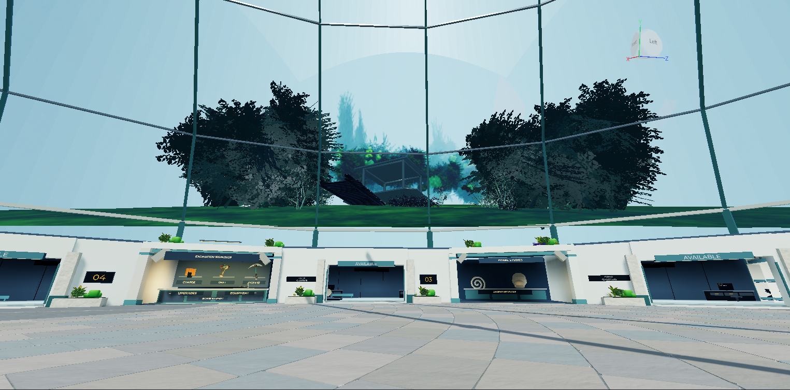
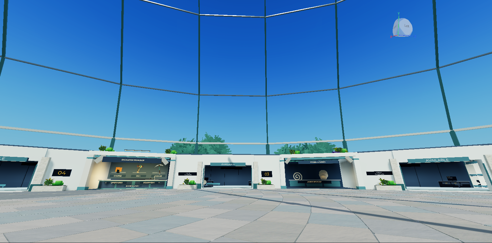
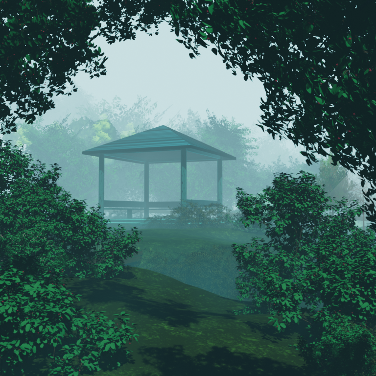
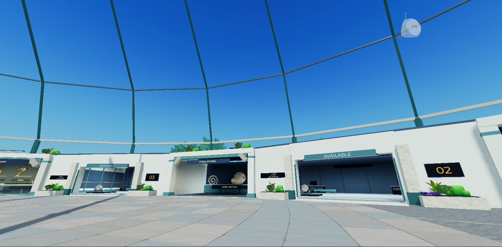
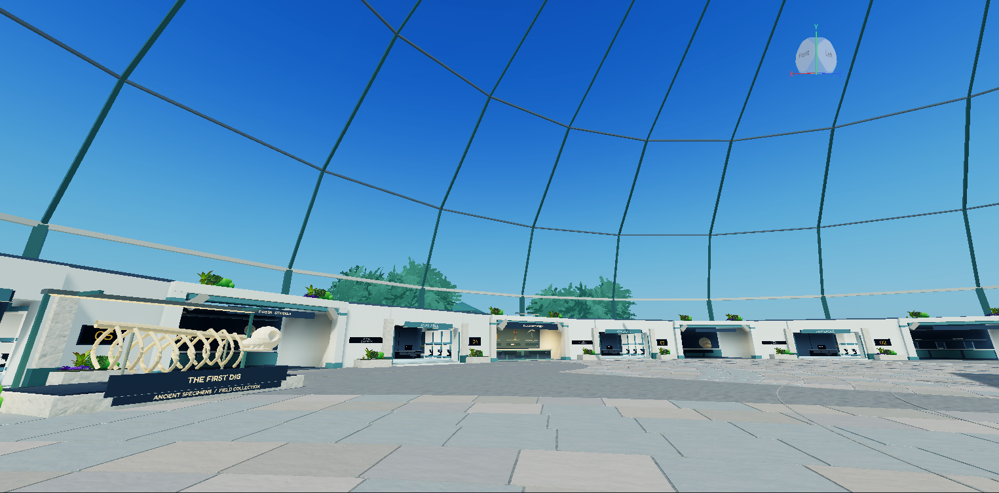

Current owner-authorized continuation: [v180 exterior composition and legacy cleanup](../exterior-composition/REVIEW.md). The distant direction remains accepted; prior placements are now retired in favor of the new asymmetric scenery. Original libraries/provenance and unresolved source rights remain retained. This historical review is not the active placement plan.

Owner update, 10 November 2026: the distant exterior direction is accepted. Earlier defect observations remain historical evidence, not a direction rejection. [Current v177 continuation and open issues](../join-dome/REVIEW.md).

# Focused Foggy Gazebo correction after v170

This is a **partial correction**, published as **v174**, not recovery of the selected scene's full atmosphere or visual approval. Original place: **94763223427049**. No new source scene, scenery expansion, interior redesign or gameplay/data change.

## Final capture plan, prepared before Play

One capture-only desktop session, maximum three minutes. Wait for ordinary loading, then attempt the fixed central camera once. On failure, stop immediately and use Edit-mode fallbacks; no camera debugging, second session, gameplay actions or device switching. Central local position `(0,7,125)`, offset `(-90,7,160)`, wide `(150,9,40)`, all transformed by Y rotation 56 degrees. Central/offset target `(30,345,1120)`, wide target `(0,230,800)`; FOV 70. The central before/after camera and viewport crop are identical. Freeze implementation after final capture.

## Backup

Private directory: `C:\Users\BOSS\Desktop\egg\Backups\FoggyCorrection_20261110\`.

- `ComingSoon_94763223427049_before_correction.rbxl`: fresh full native pre-edit recovery copy, **5,989,292 bytes**.
- `ComingSoon_94763223427049_correction_checkpoint.rbxl`: completed partial-correction native copy, saved before final capture, **5,974,580 bytes**.
- Original downloaded scene remains private and unchanged, SHA-256 `6d8e7173907018d989252e4d8ee7101dfee0ebe021fba1456bd245cfaa81c1bd`. Private Blender derivative: `correction-private.blend`; exports, diagnostic JSON, source-map inspections and construction captures are in the same directory.

Native copies preserve the DataModel and hosted asset references, not player DataStores or guaranteed standalone hosted bytes. Restoration was not tested.

## Actual diagnosis and correction

### 1. Foliage

The original `leaf.8` material uses Principled shading -> Shader to RGB -> Emission, with `leaf.9.png` supplying an alpha mask. The source tree meshes have **3,806 smooth-shaded faces** each. Their alpha image is present; it is not a missing-texture diagnosis.

The conversion replaced the leaf RGB with constant linear-looking values `(0.035, 0.14, 0.10)` but wrote PNG bytes **(9,36,26)**. That very dark color was then lit again in Roblox. The PNG alpha spans 0..255 and its silhouette was retained. Separately, all sampled colors occupied single pixels of a mostly black 64x64 palette; every polygon's UV corners collapsed to one palette coordinate. This permits mip/filter contamination and provides no coherent surface texture detail. The split mesh reconstruction duplicated corner vertices and discarded smooth flags/normals: inspected 16,000-face shrub chunks had **zero smooth faces**, unlike the source. The tree leaf/wood splitter used the same flat-face reconstruction. These are established export defects. Filtering's exact contribution to each visible speckle was not measured.

Correction: retained source leaf UVs/alpha, replaced the encoded near-black map with a readable muted albedo **(64,118,91)**, copied smooth source corner normals into the twelve leaf/wood replacement meshes, and used matte response. Removed the defective palette from shrub/wood/gazebo presentation in favor of coherent material colors. Shrub leaf geometry remains; its largest split chunks were not comprehensively retopologized. Double-sided leaves remain intentional. Source foliage contains overlapping cards; the current pass does not establish that every overlap or source normal is ideal.

The first representative tree became visibly green compared with its unchanged neighbor before applying the material correction throughout the existing group. No global light, glass or exposure change was used to obtain this difference. The final far placement makes remaining fine leaf faceting harder to assess; it is not proof that all aliasing was eliminated.

### 2. Background — unresolved

The prior conversion cropped vertical UVs to **0.17..0.74**, stretched geometry, altered its radius independently, applied **2.4x** contrast around sky color, and added overlapping solid sky-cap clones with a different untextured color. These prevent the three source renders from forming a continuous, consistently shaded projection. The far-only selection also included **Plane.301**, a non-foliage gradient plane with no image texture; it was duplicated into the bakes and produced a diagonal wedge. Its removal eliminated that wedge in the new private render.

A corrected shared panoramic projection was authored as two contiguous halves, using the real camera perspective and a common texture. Soft alpha edges exposed a specific renderer constraint: at MeshPart transparency 0 the feathered image was cut into a hard boundary; at **0.02** the background disappeared through the retained Glass dome. Roblox documents the different [SurfaceAppearance transparency blending modes](https://create.roblox.com/docs/reference/engine/classes/SurfaceAppearance). The disappearance was observed in Edit mode; this is not a general claim about every glass setup.

A source-derived forest silhouette alternative removed the rectangular boundary but revealed **detached pale foliage/card silhouettes** and did not convincingly reproduce layered mist. The source far-only bake omits the ground and foreground that ground the original composition. Additional color compensation did not resolve that structural issue. This method was stopped, not reported as success.

**Final disposition:** the failed backdrop is not displayed. Its two native templates, uploaded IDs, private bakes and authoring files are retained for review, and the Edit-only builder explicitly skips them. The old six visible background/sky-cap meshes are removed. This removes conspicuous panels, but **does not deliver the requested continuous atmospheric forest**. The blue sky visible in the final screenshots is the unchanged existing sky, not a selected new art direction. No opaque fog, darkened glass or substitute landscape was added to hide the failure.

### 3. Elevation, scale and contact

The original conversion used 22 Roblox units per Blender unit, a +340 forward offset and +60 elevation. The v170 terrain pass then set height to `0.2 * originalHeight + 0.3 * (forward - 330) + 50`, creating the conspicuous uphill strip. Individual components received different terrain-derived lifts, and the gazebo/furnishing group was subsequently scaled **1.25** around its floor pivot. This changed contact relationships: the approach path moved relative to terrain, while pillars/floor/roof did not share one seating offset.

Correction: source terrain now uses a lower profile `0.6 * originalHeight - 20 + 0.04 * max(forward - 650, 0)`, with a smoothly blended, level gazebo footprint at source-transfer height **53.26776**. All gazebo structural pieces share seating delta **-41.78553**, and the later 1.25 group scale is removed. The source wooden approach/path (`Cube.077`, previously loosely described as stairs/bench) was conformed to the corrected terrain plus one unit. We did not invent a new stair asset.

For the owner's distance clarification, the corrected landscape uses one common **0.85** scale plus **400 units farther along the sector axis**, rather than enlarging close bushes. Terrain begins about **680.5** units forward on that axis, instead of 330. The gazebo and vegetation retain the corrected relative terrain positions. Exterior meshes remain anchored with collision/touch/query disabled. No new outside entrance or playable area was created.

**Remaining placement limitation:** the unchanged low interior viewpoint and retained frontage occlude much of the now-distant low landscape. The shelf and floating approach are no longer visible above the rooms, but the scene is too sparse from these viewpoints; absence of visible floating contact is not a complete player-view contact verification. The gazebo is secondary and largely hidden. Further elevation/composition variants were not attempted after the documented stopping point.

## Final evidence

All three exterior views below are actual **Edit-mode** screenshots, cropped only to the viewport, without retouching or color changes. They were checked for unrelated private information. The single **22.63-second** Play capture attempt did not hold the requested camera; its [room-view evidence](runtime-attempt.png) is retained. Play stopped immediately, with no second attempt, gameplay action or device change. Studio finished in Edit mode. No correction followed final capture.

| Fixed central view before | Same camera after |
| --- | --- |
|  |  |

| Original Blender baseline | Current Roblox result, Edit mode |
| --- | --- |
|  |  |

| Offset, Edit mode | Wide, Edit mode |
| --- | --- |
|  |  |

Final visible issues: large empty sky area; only tree tops readable over the frontage; little convincing forest layering; gazebo mostly hidden; original muted/misty atmosphere not recovered; overall continuous scenery around the dome not established. The bright interior and existing unapproved room/world presentation remain unchanged. This is not a successful completion of the atmosphere objective.

## Preservation, files and rights

Static non-exterior preservation signature remains **14,738 parts / 1383861112**, identical to before. Egg, dome, interior access, rooms and anchors are preserved. Lighting brightness 2.4, clock time 14.2 and ambient `(0.32549,0.376471,0.427451)` are unchanged. No runtime gameplay scripts, UI, economy, rewards, progression, player profiles or save generation changed. No gameplay, persistence, streaming, live-client asset or mobile performance verification is claimed.

Canonical source: `src/FoggyGazeboBuilder.luau` / `ServerStorage.VesperTools.FoggyGazeboBuilder`, revision 2. **82 placed meshes**, 84 retained templates (two unused backdrop templates), **567,542 placed triangles** by source metadata; not a measured performance result. [Exact current mesh/image IDs and placements](asset-inventory.json). New leaf map: `137012180294436`; failed backdrop maps are retained but not displayed. One native correction import replaced existing components, not an additional scene.

Original authoring scripts are under `assets/environment/foggy-correction/authoring/`; they require the private source and previous conversion. Restricted Blend/FBX/image sources remain under ignored `Backups`. The existing [Blendkit/Maxtree unresolved-rights record](../foggy-gazebo-transfer/REVIEW.md#rights-and-private-sources) remains unchanged; no rights clearance, ownership claim, purchase or new licensing investigation occurred. Blender 5.2.3 LTS was used. Read-only source inspection and native asset import are not gameplay tests.

During new asset loading, Studio reported texture representation generation and temporary asset-delivery failures. The final cutout appeared for inspection but was rejected on appearance and removed from display. Upload success is not proof of live asset availability. The private Blender bake also repeated the prior `Unable to delete file` shutdown warning after saving its renders.

## Publication and stop

Studio logged `PublishSuccessful`, `Publish succeeded for placeId 94763223427049`, and `Add publish notes to v174` at **2026-11-10 15:04:55 UTC**. This records publication to the same experience, not visual success or live gameplay verification. Branch: `planning/development-foundation`. No merge, access-permission change or player-data operation. The checkpoint is frozen for owner review; no further environment iteration or broader milestone is authorized by this delivery.
