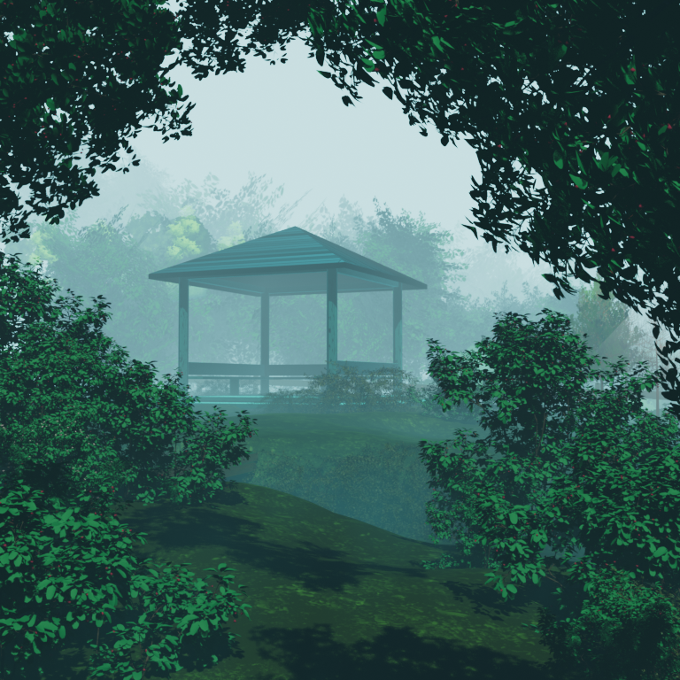

# Selected Foggy Gazebo scene transfer

Original target: **94763223427049**. Branch: `planning/development-foundation`. This is an implementation checkpoint, not visual approval. The previous exterior was published as v162. Final publication/capture status is recorded below when available.

## Source and transfer

The owner selected [Stylized Anime Foggy Gazebo Nature Scene by sivix gamer](https://www.blendkit.com/asset-gallery-detail/dc5632f8-2513-4b53-9f5f-096fd493e261/), downloaded version `4ad27ae1-25e2-4f34-92cc-32341200fea0`. See [original inspection and renders](../blendkit-gazebo/README.md). This implementation uses that downloaded scene's terrain, gazebo, furniture/fence, shrubs, tree geometry and rendered distant forest, rather than a substitute pack.

The scene was processed in the installed portable Blender **5.2.3 LTS**, with embedded script auto-execution disabled. Private working copies retain editable converted geometry. The original remains unchanged at SHA-256 `6d8e7173907018d989252e4d8ee7101dfee0ebe021fba1456bd245cfaa81c1bd` (728,214,055 bytes).

- **3D geometry:** source landscape, gazebo and related furniture/fence; source shrubs and six framing-tree instances. Dense source geometry was decimated and split for native Roblox mesh import. Twelve extra source-shrub placements extend the flanks; floating/occluding source clusters were omitted or relocated. Source local X is mirrored during Blender-to-native-import conversion; this is not exact original-camera staging.
- **Terrain adaptation:** the connected source surface is compressed vertically and raised gradually behind the dome so the landmark can be seen above retained room frontage. Vegetation is seated using sampled terrain heights. Gazebo/furnishings are enlarged 1.25 around their assembly pivot. The original interior is not lowered, moved or rebuilt to reveal the scenery.
- **Materials:** source material/image colors sampled into a shared palette, forest ground rendered to a 1024-pixel map, framing-tree leaf opacity retained in a 512-pixel cutout. Blender Shader-to-RGB, procedural nodes and view-dependent effects are not running in Roblox. This conversion loses source shading detail and does not reproduce native ACES/EEVEE material response exactly.
- **Distant forest:** three 1024-pixel source-derived forest bakes on curved meshes, with separate upper color continuations. These preserve distant layers while nearby shrubs, trunks, terrain and architecture retain real depth. Contrast/mist strength is compensated for existing Roblox atmosphere. This is not a claim of seamless parallax or original fog equivalence.
- **Fog/lighting:** distant mist is baked, rather than a new dense global fog volume. Existing global lighting and dome glass remain unchanged. No exterior lights, particles, moving props or gameplay are added.

## Actual integration and retirement

Placed under `Workspace.VesperLab.DecorativeExterior.FoggyGazeboExterior`, divided into `AuthoredTerrain`, `GazeboAndFurnishings`, `ForegroundVegetation`, `ForestWings`, and `BakedDistantForest`. Reusable native templates are `ServerStorage.FoggyGazeboAssets`; Edit-only source is `ServerStorage.VesperTools.FoggyGazeboBuilder`, mirrored in `src/FoggyGazeboBuilder.luau`.

The affected sector is centered on bearing 56 degrees from +Z. Retired roots are `DecorativeExterior.EastValleySector`, `LandscapeGroup1`, `LandscapeGroup4`, `LandscapeGroup10`, and four overlapping old `Mountain` roots within the -35..147 degree cone (old names included duplicate Mountain2/Mountain3 names). `ScenicBase` and other exterior sectors remain. Exact prior instances are preserved in the native backup; duplicate old names are not described as unique identifiers.

`ValleySectorBuilder` now refuses to run after `FoggyGazeboRevision` is present. Earlier living-lab art builders already have revision guards. The new builder is an Edit-only authoring module; no new startup, round-transition or runtime callback was introduced. This prevents the known older authoring recipe from replacing this scene, without changing egg lifecycle code.

The [asset inventory](asset-inventory.json) records every actual uploaded template mesh/texture ID, source object name, triangle count, placement path, dimensions, position and surface map. It contains **85 templates / 568,406 template triangles**, **88 placed MeshParts**, including three extra upper-background continuations. This is a static asset count, not a measured rendering cost. Every placed mesh has collision, touch and spatial-query participation disabled. The existing enclosed dome retains the gameplay boundary; scenery creates no outdoor entrance or interaction.

## Rights and private sources

The scene listing is **Royalty Free, not CC0**, under [Blendkit licensing](https://www.blendkit.com/docs/licenses/). The owner explicitly authorized this transfer while retaining unresolved constituent rights. Packed paths identify **Maxtree Plant Models Vol 6**, ForestGround02 and Wood063; the uploader's rights to those constituent assets have **not** independently been established. No ownership or clearance claim is made. These components are used in the derived foliage, palette/ground/leaf maps and forest bakes; they remain replaceable through the inventory.

Only our assembly source, asset references, documentation and permitted rendered review outputs are public. The original scene, packed images, raw extracted maps, adapted FBX/Blend files and runtime image files stay private. Roblox asset uploads are implementation distribution, not evidence that constituent licensing is settled. Rendered outputs being allowed does not clear the underlying component rights.

Reused matte roughness map `113355786572368` is the existing project CC0 material resource; its earlier provenance remains in the environment asset records. All other current mesh/image references are listed individually in the inventory. No purchase or new subscription was made.

## Recovery and preservation

Fresh native backup before editing:

`C:\Users\BOSS\Desktop\egg\Backups\FoggyGazebo_20261110_implementation\ComingSoon_94763223427049_before_foggy.rbxl` — **4,497,679 bytes**.

The same private folder preserves pre-change `src`, `docs`, `AGENTS.md`, previous valley editable assets, `conversion/` scripts and editable Blender copies, and `exports/` FBX/maps. Untouched downloaded original: `Backups/BlendkitInspection/original-scene.blend`. Native backup covers the whole DataModel and asset references, not DataStores or a guaranteed independent copy of every hosted asset. Restoration has not been tested.

Static readback before/after: **14,738 non-exterior BaseParts**, identical sorted property signature **1383861112** (path, transform, size, collision, color, material, transparency and mesh ID). Lighting remains brightness 2.4, clock time 14.2 and ambient `(0.32549, 0.376471, 0.427451)`. This supports preservation of the egg, dome, interior/access geometry and anchors; it is not gameplay verification. No gameplay script, save generation, player profile, economy, UI or progression rule was changed.

## Bounded capture plan

Before any Play, prepare central, offset and wide views using the sector basis `Y=56 degrees`: local camera positions `(0,7,125)`, `(-90,7,160)`, `(150,9,40)`, aimed toward the scene with interior context. At most one desktop capture-only session, maximum three minutes, no gameplay actions or device changes. If camera/capture is blocked, use clearly labeled Edit-mode views. Freeze implementation after the final capture session; record issues without a correction loop.

At documentation preparation, **no Play session has started**. Windows is showing its lock screen; native fresh captures and save/publish await the owner unlocking the desktop. A Studio capture RPC also stalled; old native window captures may show stale frames and must not be presented as final evidence.

Native checkpoint saving was attempted once after the lock was established. Windows UI Automation returned `ElementNotAvailableException` / `Studio native dialog unavailable`; RobloxStudioBeta reported `MainWindowHandle=0`, with LogonUI active. No final native checkpoint file was created by that attempt. MCP still reports Edit and returns the applied DataModel. Publication has not been attempted while this blocker remains; **no new published version is claimed**. The existing pre-edit native backup is intact. The desktop lock-screen image is private and is not included as environment evidence.

## Known limitations before final capture

Construction views showed darker foliage, flatter ground shading and less soft layered depth than the Blender baseline. Retained room frontage partly occludes low scenery. The last background and terrain adjustments still need a fresh rendered inspection; mesh/source readback alone does not establish the final appearance. Curved-bake boundaries, upper-sky transitions, side coverage and source furniture seating remain review risks. No mobile performance, gameplay, streaming, published asset-permission or physical-device verification has occurred.
