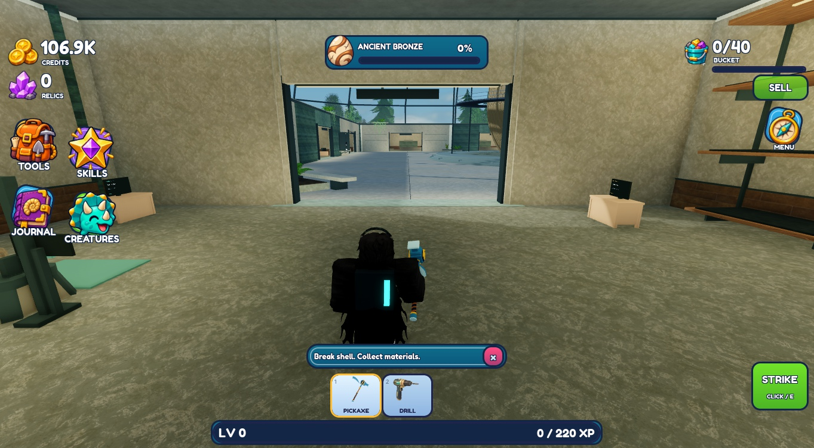
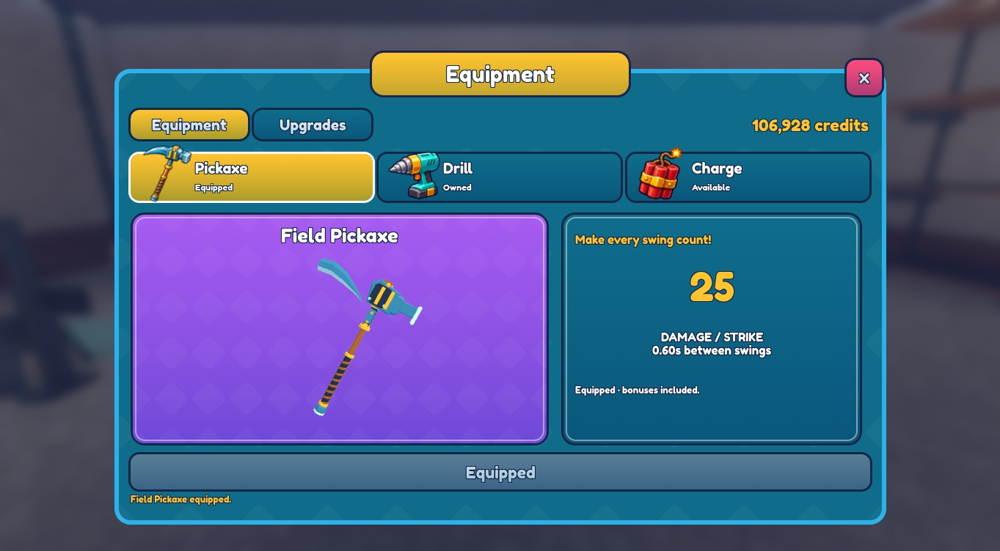
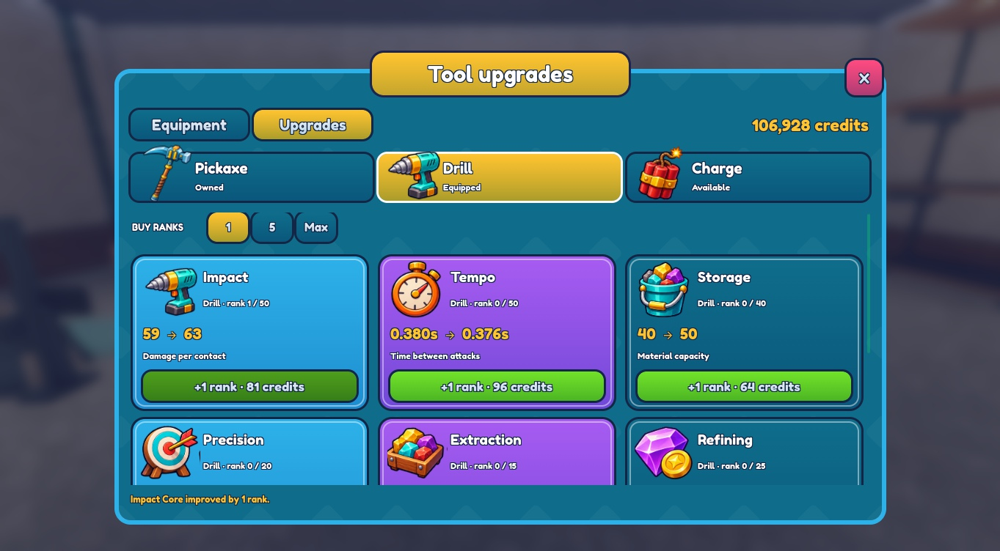
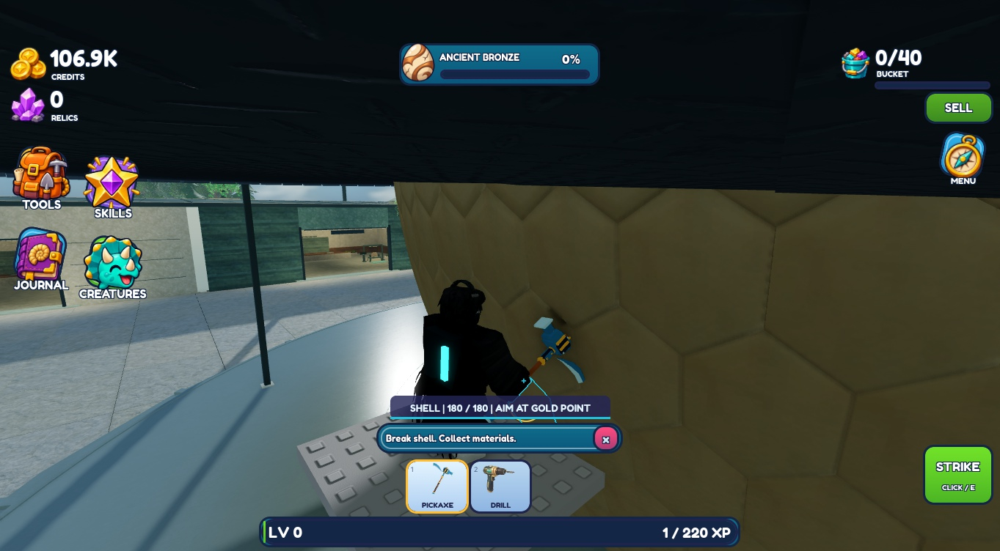

# Roblox identity slice — published v235

Original place **94763223427049**, branch **planning/development-foundation**. Publication confirmed at **2026-11-11 11:27:33 UTC** by Studio's `publishType=1`, `PublishSuccessful`, original place ID and “Add publish notes to v235” log entries. The older `game.PlaceVersion` value in the still-open editor is stale. Studio is in **Edit**.

This replaces the rejected v230 HUD/equipment composition and pickaxe. Illustrated edge navigation, outlined currency numbers, the actual level/XP bar, expandable utility icons, integrated tool tabs, layered shop framing, large damage/cost/gain values and world-only modal blur are implemented. Hover/press feedback and a brief confirmed-transaction response respect reduced motion. Existing purchase/equip/upgrade handlers and server rules remain authoritative.

The finished [Baziliq Games PK-001](https://baziliqgames.itch.io/stylized-pickaxes) replaces the rejected model in templates, workshop display and previews. Authored bevels, fittings, rivets and grip wrapping are retained; fitting/material changes only. [Exact provenance, private files, licence limitations and upload IDs](../../../assets/tools/identity/SOURCES.md). The author discloses an AI-assisted procedural workflow. No owner visual approval is claimed.

## Actual runtime screenshots

## Focused checks

- One **5-minute-35-second** Studio session, using memory-only profiles. Drill purchase **125,000 → 107,000**, equip, first Impact upgrade **107,000 → 106,928**, rank **0 → 1**, displayed damage **59 → 63** for the next rank. No production data writes or generation changes.
- Pickaxe/drill/charge tabs changed artwork, preview, stats and action states. Purchase/equip/upgrade receipts updated the existing UI. Closing/reopening and the utility-to-settings route worked.
- At 374×666 portrait emulation, equipment and upgrades scrolled, with close and primary action visible. [Equipment](narrow.png), [scrolled stats](narrow-scroll.png), [upgrade card](narrow-upgrades.png). Two narrow-HUD overlaps found in runtime were fixed and rechecked using the production layout in an [Edit render at narrow dimensions](narrow-corrected.png). That final spacing correction did not require another gameplay session.
- Blur reached **20** when open and returned to **0/disabled** on close. Reduced motion persisted in the isolated account and left hovered button scale at **1**. A temporary Edit-preview blur was removed; no preview instances/effects remain in the saved place.
- Replacement held correctly in the observed R15 pose. One actual strike changed plate HP **180 → 155** and contribution by **25**. Tool switching returned to the pickaxe; no IK rewrite or microscopic contact audit. Unchanged drill/blast mechanics were not retested.
- Changed Luau passed targeted syntax/format checks. Exact live source readback matched canonical files, including restored unmodified `ExcavationService`. Temporary fixture removed before backup/publication. No new VesperShared runtime errors observed.

## Remaining scope and limits

No known blocking regression remains from this pass. Owner visual review is pending. Full multiplayer, R6, gamepad, performance and published-session asset delivery were not retested. Actual in-hand capture is under the existing excavation access structure; the environment is unchanged.

Skills, Journal, Collection, Room, Settings and Results still await this design rollout after review. Image 06 guides future time-played reward presentation; no reward system was added. Image 07 retains future server-confirmed training gains with the correct resource icon, short upward fade and matching counter/bar feedback. Rebirth, trading, worlds and monetization remain deferred. Do not automatically extend this slice.

Private native before/final recovery: `Backups/IdentitySlice_20261111/ComingSoon_94763223427049_before.rbxl` and `Backups/IdentitySlice_20261111/ComingSoon_94763223427049_delivery.rbxl`. Original workspace was clean at `dab340738d6f2d0e6b95fff1df2906d6f84abcad`; no newer work was overwritten. Saved game values, fixed save generation, environment and friend-access settings remain preserved. See [delivery identity](delivery.json).
