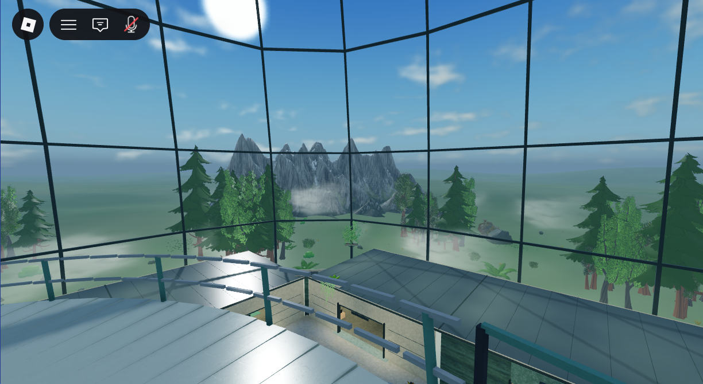

# Phase 3 — planting, exterior composition, mist and lighting

**Published v215** to original place **94763223427049** at **2026-11-10 23:50:40 UTC**, branch `planning/development-foundation`. Studio's log records `publishType=1`, successful publication to that place, “Published new changes” and “Add publish notes to v215”. The preceding Download a Copy was a native recovery/cloud save, not the publication evidence. [Git delivery identity](delivery.json).

Started from clean **bab58e80ac35c51c4b4ef2996c4c01f073037dc7 / v212**. All six specified owner references were inspected. The original place is the only implementation target; backups were never opened as development places. Studio is stopped in **Edit**, the original graphics settings are restored and art is frozen after final capture. This is implementation evidence, not owner visual approval.

## Delivered environment

Finished **Grab3D Ivy on Trellis** and **Hanging Vine** meshes replace the disconnected primitive vines. Their connected stems/leaves are used in four stationary frame gardens, uneven groups on six room roofs, the fixed outboard access support and fixed outer crown braces. Soil pockets and solid supports give the growth an origin. Room03/Room09 and access pockets are reused; other roof groups differ in length and coverage. Two shared ground beds were replaced with separated canopy/fern/broadleaf planting, exposed soil and the retained bench identity. Personal-room interiors, collections and training equipment were not rebuilt.

Existing Innerscene mountain, Poly Haven buttress and Quaternius/KayKit vegetation meshes were recomposed. Ten irregular woodland clusters span approximately 300–540 studs from the center; selected foothills now sit between those groups and the mountains. Five differently rotated/scaled massifs remain separated by openings. Bases are seated against the existing ground. All 64 ground tiles and sixteen terrain-fitted grass meshes retain their transforms. No new mountain set or terrain world was created. [Actual asset sources, licenses, hosted IDs and provisional replacement records](../../../assets/environment/phase-3/README.md).

Twelve localized exterior mist layers replace eight broad farther ribbons. Four nearer groups sit just outside selected glazing sectors; additional layers separate woodland and foothills. The existing continuous sinusoidal drift, texture motion and native cloud wind remain, with opacity bounded to valid values. The glass envelope, opacity and structural transforms are unchanged. Afternoon time remains **16:00**; brightness/specular contribution are reduced, ambient light is more neutral, and sixteen frontage/service lights use a softer coordinated tone. Phase 2 room PointLights remain unchanged.

## Actual evidence

All images are unretouched 1224 × 670 crops of actual Studio captures. Full-window originals remain private. No roof or glass was hidden for this phase. The outside aerial is labeled separately and does not replace the reachable upper view inside the dome.

| Required view | Evidence |
| --- | --- |
| Matched floor-height, through dome | [Before Edit](screenshots/before-floor.png) / [after Edit](screenshots/final-edit-floor.png); [runtime floor](screenshots/final-runtime-floor.png). Same `(65,7,50)` camera, FOV 70. |
| Matched reachable above-egg view **inside** dome | [Before Edit](screenshots/before-upper.png) / [after Edit](screenshots/final-edit-upper.png); [runtime upper](screenshots/final-runtime-upper.png). Same `(3,97.1425,-23.5)` terminal-deck eye-height pose, FOV 70. The pre-existing purple excavation representation is visible only in these Edit views; runtime shows the actual access deck. |
| Opposing interior direction | [Runtime opposing view](screenshots/final-runtime-opposing.png). |
| Glazing/frame vines | [Actual close view](screenshots/final-runtime-frame-vines.png). |
| Roof planting | [Actual close view](screenshots/final-runtime-roof-planting.png). |
| Ladder/fixed support integration | [Actual close view](screenshots/final-runtime-ladder-planting.png); ladder and landing remain clear. |
| Shared ground planting | [Actual ground-bed view](screenshots/final-runtime-ground-planting.png). |
| Complete composition | [Outside inspection aerial](screenshots/final-edit-overhead.png), dome and existing landscape together. |
| Same-camera lowest/highest quality | [Observed Q1](screenshots/observed-lowest-quality.png) / [observed Q21](screenshots/observed-highest-quality.png). Matching CFrames recorded; principal mountain and tree silhouettes render in both. Q1 visibly reduces detail and edge quality. This is one Studio comparison, not proof of all-device visibility or performance. |
| Gentle motion, after loading | [18-second normal-speed fixed-camera MP4](mist-motion.mp4), 216 real frames at 12 fps. [Capture timing](motion-timing.json) and [encoded-file metadata](motion-file.json). Both cloud motion and localized mist drift are visible; the camera remains fixed. No generated or interpolated frames. |

[Prepared camera poses](cameras.json). One **391.106-second (6m 31s)** capture-only Play session. It took longer than planned because client quality setters were refused and the native quality menu's final entry extended below the window crop. Actual Q1 and Q21 were selected in Studio's quality UI; the first failed-preparation “lowest/highest” files are excluded. An initial recording with incorrect Windows DPI bounds was discarded; the delivered recording uses the corrected physical viewport and contains no loading frames. No second Play session, device switch, character navigation, mining, purchase, training test, grant or save mutation occurred. Existing Studio preview isolation remained active. ScreenGuis and temporary camera control were restored/removed; settings returned to Level21 / Edit Level21 / SavedQualityLevel10 / Edit FRM false. [Full capture record and Output](capture-record.json).

## Cleanup and preservation

[Replacement ledger](replacement-ledger.md) identifies exact removed roots and generators. The old retained stems/petioles/leaves, seven nested hoist moss blocks, old Commons beds and superseded exterior placements are removed from the active place. The old radial compression is retired; LabInteriorBuilder forwards planting/lighting to the current recipes. `Phase3EnvironmentBuilder` is the combined environment-only entry; no competing legacy layout remains active. Recovery copies are private, not hidden scene objects.

[Preservation comparison](preservation-comparison.json): **15,410 protected BaseParts** match in geometry/material/color/collision, including the twelve rooms and their exteriors, dome, egg/access/delivery and services. All **39 functional ObjectValue anchor paths** match. Of **80 current runtime sources**, only ExteriorAtmosphereConfig and ExteriorAtmosphereMotion changed. Training, joining, room ownership/collection, economy/progression/equipment and fixed save generation **VesperDiscovery_FreshStart_20261110** remain unchanged. No functional anchor migration was necessary.

[Static checks](static-results.json): no inspected legacy planting names remain; 59 shared planting meshes are noncolliding/non-touching and 23 solid planter/support/seat pieces collide. Focused linting reports zero errors, warnings or parse errors. [Ten canonical/live source comparisons](source-sync.json) match. These checks do not establish frame rate, mobile performance, all routes or gameplay behavior. No unrelated gameplay audit was run.

## Shortcomings recorded at the freeze

- Roof greenery still reads as separate planter groups, with repeated rounded hanging-vine heads and some curtain-like trailing shapes. Frame gardens remain fairly compact in wide views; this does not yet match the breadth of the positive owner reference.
- Ivy/ferns are bright in direct light. The canopy in the ground bed is narrow and sparse; the bed and surrounding floor remain visually broad. Upper metal roofs/access surfaces still show strong sun highlights.
- Room frontages continue to hide much of the low landscape from floor height. The upper view communicates the scenery and mist more clearly. The inspection aerial still exposes substantial open ground and distinct mountain islands; the composition is improved locally, not a fully continuous natural terrain system.
- Mist is clearly visible in the recorded principal view, but it remains beam-based and can read as individual soft patches. Other camera angles, published clients, long-duration looping and real low-end devices were not independently measured.
- Output reported pre-existing texture-load failures for **135244070369997** (drill display/equipment) and **106778120705313** (reused foothill RockButtress texture). Geometry remains visible in the captures; consistent texture delivery is unresolved. The exact paths are in the capture record. No post-capture repair loop was started; the drill issue is retained for Phase 4.
- Grab3D's CC0 claim has no separately named upstream artist in the saved pages. Both plants remain provisional in the asset replacement ledger; no blanket rights clearance is claimed. Earlier restricted-asset records remain intact.

No mobile, tablet, console, multiplayer, live-save or gameplay testing was performed. Publication/source synchronization do not establish visual approval. Phase 4 tools/charges, Phase 5 complete UI replacement and every other deferred requirement remain in [PLAN.md](PLAN.md); none began here.

## Private recovery

`C:\Users\BOSS\Desktop\egg\Backups\InteriorPhase3_20261111\`

- `ComingSoon_94763223427049_before.rbxl`: **6,589,977 bytes**, SHA256 `F2008DFD1CB524E56614CD66372EAD3439D756F084C1F387E30F615668AA0419`.
- `ComingSoon_94763223427049_final.rbxl`: **6,639,782 bytes**, SHA256 `C899BF01F5F09FDAD9358173AD1942C9959F3A4A8BFE1CFF6D87241A39FF62C0`.
- Source snapshot, exact before-placement inventories, downloaded originals/pages, editable plant masters, full screenshots, motion source frames and native-save helpers are preserved alongside them. These are development recovery copies, not player-progress backups.

[Git commit and push identity](delivery.json). No main merge or force push.
