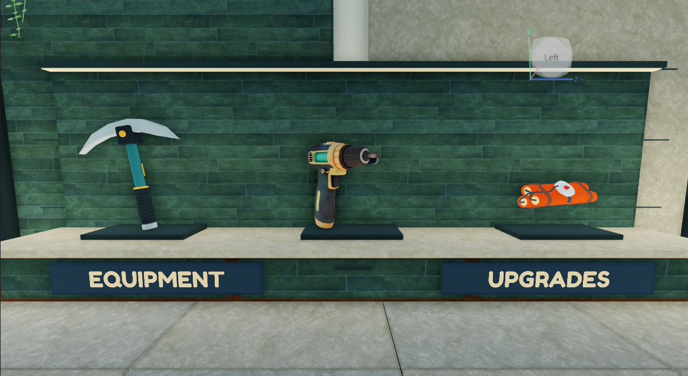
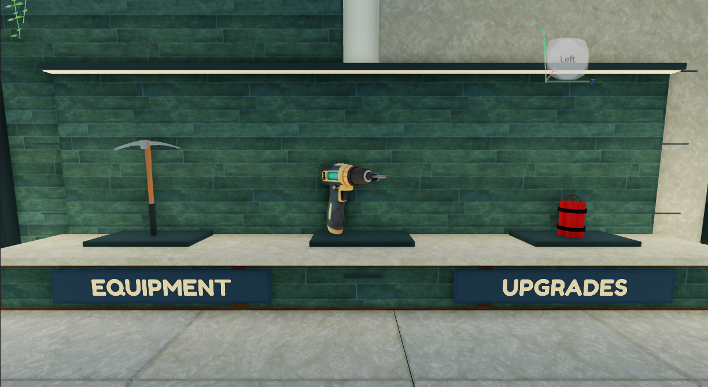

# Phase 4 tool presentation — published v221

Original place **94763223427049**, branch **planning/development-foundation**. Baseline was clean at **475f40994c69f07bafca283ad3d22a9fa9f91077**, reported v215. Published **v221** at **2026-11-11 01:05:14 UTC**, verified from Studio's `publishType=1` success and version log. Studio is stopped in **Edit**. [Delivery record](delivery.json). Publication is not owner visual approval.

The explosive and pickaxe actual models were replaced, with matching functional templates, held copies, placed charge, physical workshop and equipment ViewportFrames. The existing Helix drill was retained with its body texture repaired, a readable protruding working bit and corrected stop behavior. [Exact assets, authors, licenses and IDs](../../../assets/tools/phase-4/SOURCES.md). [Removed instances/generators and migrated tool anchors](replacement-ledger.md).

## Concrete corrections

- The old pickaxe grip/working point described the rejected mesh. New measured geometry, grip and swing/contact/recovery poses replace them. Verification exposed a pose conflict: the post-animation arm pose overwrote the IK result. The final code blends the solved contact pose and reconciles local anticipation with the server windup. A remaining approximately **0.7-stud** sampled tip offset is disclosed below.
- The drill warning named body texture **135244070369997**, not its handle/bit or the separate foothill texture. Roblox metadata said Approved/Active, and its original pixels could be read, despite the earlier runtime representation warning. The exact 1024×1024 pixels were republished as **100714057797210**. Both focused sessions loaded the repaired drill without that warning in the captured console. Bit rotation and contact remain separate from pickaxe swing; stop/switch clears spin, IK state and loop sound.
- Previously the client drew a small local charge cue and a large blast accent rather than the equipped charge model at the authorized surface. Placement now creates one replicated model only after existing server checks pass, seats it using the hit normal, and removes it on cancellation/detonation/support loss. The client waits for server acceptance before placement animation/confirmation. Both sides use the same geometric contact helper; all server eligibility and ownership checks remain authoritative.
- The first implementation's cloned `WeldConstraint` was a concrete defect found in verification: it was not covered by `IsA("Constraint")` or `IsA("JointInstance")`, so a placed clone tethered the held tool and displaced the character. Explicit WeldConstraint removal corrected it. An initial MCP-context patch did not update the game script's module cache; the correction was then applied in the actual game Script context and verified, before synchronizing the same source into Edit. No temporary patch script remains in the published place.
- The giant central sphere and duplicate central impact call were removed. One deduplicated flash, shell dust/chips, restrained smoke and existing sound replace them. Effects do not apply damage, physics knockback or rewards. Reduced-motion and SFX handling remain in the presentation path.

Damage, reach, cadence, the **0.45-second fuse**, radius **6**, maximum **7 sections**, edge multiplier **0.35**, ownership, rewards and progression values are unchanged. The existing rules cancel a pending explosive on a tool switch; they still do. An already-authorized blast retains its original layer/position if another action breaks its supporting section, while its unsupported visual is removed.

## Observed behavior

The initial **282.501-second** session used the existing **STUDIO PREVIEW** memory-only branch. A temporary standing platform beside a real shell plate allowed focused tool views without changing the egg or balance. Ordinary keyboard input exercised the client route; one explicitly out-of-reach request additionally exercised server rejection. No purchases, resets, new grants or production writes occurred. The displayed 100M credits/all-tool access were pre-existing preview defaults.

| Check | Observation |
|---|---|
| Pickaxe | One request, one 25-damage hit: target HP 180→155 |
| Drill | Two requests/ticks, 55 damage each: 155→100→45; 13 distinct sampled rotor transforms and a playing loop sound |
| Switch during drilling | Switching to pickaxe stopped further drill hits and the loop; no stale drill damage followed |
| Invalid explosive | Out-of-reach request received `Miss`; zero placed models, unchanged target HP, no blast |
| Corrected explosive | One model, zero clone welds, one blast event, seven unique section-hit records; target's remaining 155 HP became 0. Character position before/after was identical. Model lifetime was **0.4646 seconds** under the unchanged 0.45-second scheduled fuse; zero remaining placed models and burst particles cleaned up |

The concrete contact/clone failures required one **206.783-second follow-up session**. It contained one pickaxe strike and three charge attempts while diagnosing the actual script-context clone correction; only the final attempt established successful blast damage. This exceeded the initial one-detonation sequence under the brief's specific functional-failure follow-up exception. It was not an art-tuning loop. Both earlier failed blast attempts are retained in the behavior record rather than reported as successful damage checks.

[Measured requests, damage, placement lifetime, hit records and limitations](behavior-evidence.json). The final invalid-target reason now distinguishes OUT OF RANGE before obstruction; this narrow source correction was statically checked after capture and was not followed by another Play session. The invalid screenshot therefore shows the earlier generic blocked label. Visual art froze after the final captures.

## Actual Studio evidence

Matched Edit workshop views show both replaced models:

| Before | After |
|---|---|
|  |  |

[Equipped pickaxe](equipped-pickaxe.png) · [Equipped drill](equipped-drill.png) · [Equipped explosive](equipped-charge.png) · [Final pickaxe contact](pickaxe-contact.png) · [Corrected aligned charge](placed-charge.png) · [Detonation](detonation.png) · [Actual equipment shop preview](workshop-equipment-ui.png) · [Invalid request view](invalid-placement.png).

Normal-speed, actual loaded runtime recordings, **12 fps**, no synthesized frames or loading footage:

- [Final pickaxe contact — 5 seconds](followup.mp4), trimmed before the diagnosed charge attempt.
- [Drill operation and switch — 13 seconds](pick-drill.mp4); this initial-session clip also shows the earlier pickaxe contact pose, superseded by the final pickaxe clip.
- [Final corrected charge placement/detonation — 7 seconds](charge.mp4).

Clips have **no audio track**. Sound playback state was observed, but audible sound quality was not verified.

## Remaining limitations and preservation

The pickaxe's sampled working tip remains roughly **0.7 studs** from the authorized impact around contact; it is improved, not perfectly registered. Far targets within the unchanged gameplay reach can exceed the visible arm/tool's physical reach; no character teleport or reach/balance change was added to conceal that. The finished pickaxe has a thin, simple head, and the charge's red body/branching fuse remains visually plain. The current dark avatar and large unchanged HUD obscure portions of equipped views; the interface remains Phase 5 work. The blast's short flash is harder to judge at 12 fps. No autonomous post-capture art revisions were made.

Death/respawn, R6/other avatars, multiplayer ownership/interruption, support removal by another player, a separate blocking-menu interruption, runtime reduced-motion/SFX toggles, mobile/controller performance and published-client rendering remain unverified. Source lifecycle checks do not prove these runtime cases. The one-shot explosion sound's later expiry was source-reviewed; the saved samples establish burst/model cleanup, not audible completion.

Static preservation matched **15,952 protected VesperLab parts**, checksum **7b89ea31**, and global lighting. Only the 16 explicitly scoped source paths changed/appeared; other sampled runtime sources, including save-generation, economy, progression, training and delivery modules, match the baseline. The fixed generation remains **VesperDiscovery_FreshStart_20261110**. The exterior, dome, rooms, service architecture, egg geometry and training layout were not rebuilt. [Retained Phase 5 and deferred requirements](PLAN.md).

Private native recovery:
- Before: `Backups/InteriorPhase4_20261111/ComingSoon_94763223427049_before.rbxl` — 6,639,782 bytes, SHA256 `C899BF01F5F09FDAD9358173AD1942C9959F3A4A8BFE1CFF6D87241A39FF62C0`.
- Final: `Backups/InteriorPhase4_20261111/ComingSoon_94763223427049_final_verified.rbxl` — 6,617,124 bytes, SHA256 `FF05B2769FDC78FCA92B2BF40C52EA000DC825206B464F4992614866436A668A`.
- Original source snapshot, raw captures, observers, requests and asset originals remain in the same private folder. Recovery copies were not opened as development targets.

The interrupted friend-access investigation made no audience/collaborator changes. No claim is made that the friend can now join; Phase 4 publication did not alter that configuration.
