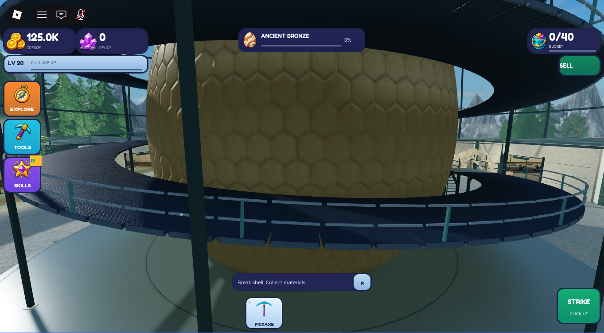
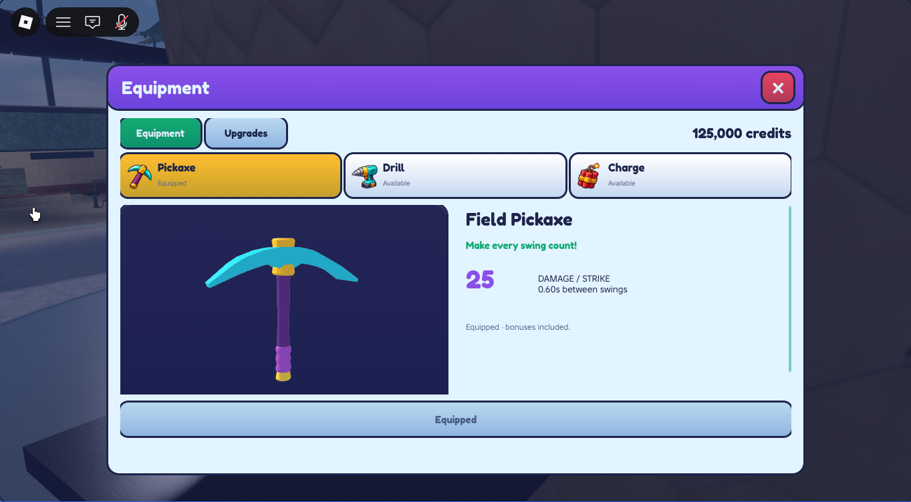
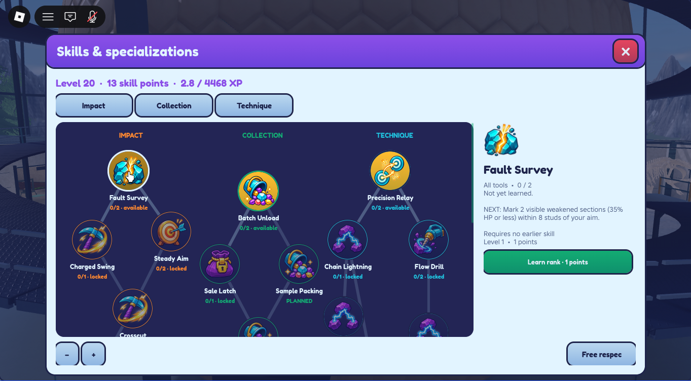
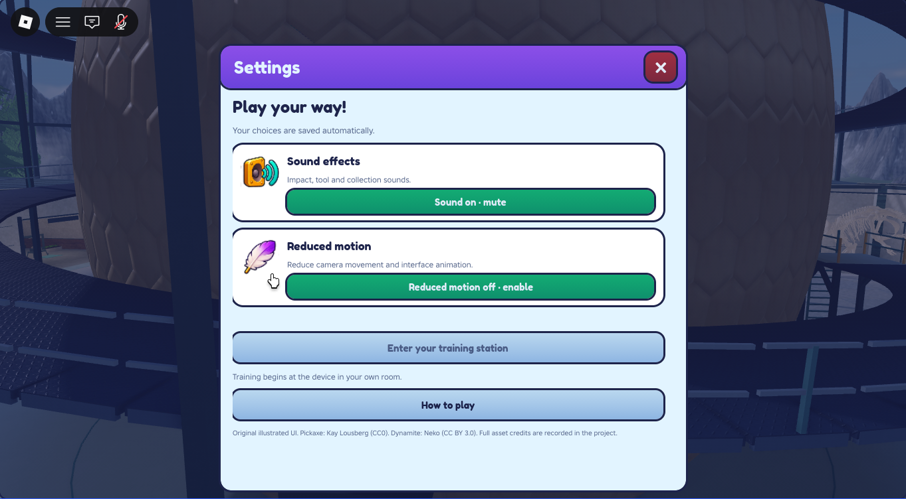
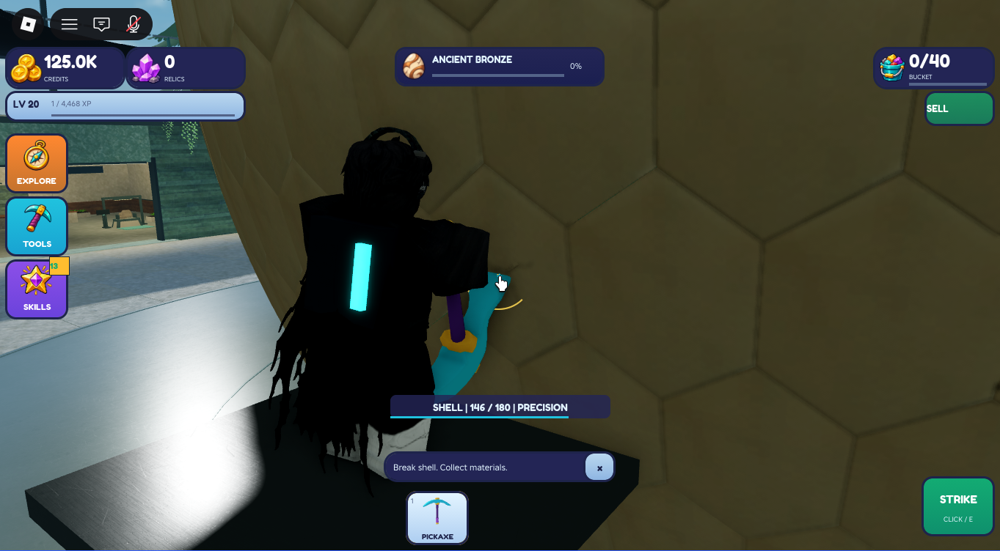

# Playful interface and tool replacement — published v230

Delivered to original place **94763223427049** on `planning/development-foundation`. Publication at **2026-11-11 10:29:04 UTC** is verified by Studio's `publishType=1`, `PublishSuccessful`, exact place ID and “Add publish notes to v230” log entries. [Delivery identity](delivery.json). The rejected v223 parchment/mineral direction is historical, not approved.

The owner authorized the full replacement, downloads/uploads, isolated runtime checks, original-place publication and branch push. The workspace was clean at **6cb2768af4152abe34b29f5435c5f07c6a6e9549** before implementation. No delegates, account reset, friend-access work or environment redesign were performed. Studio is stopped in Edit with desktop simulation restored.

## Delivered

One original cyan/purple/gold cartoon system now supplies the HUD, navigation, equipment/upgrades, illustrated skill tree, journal/discoveries, collection/room menus, settings/controls, materials, egg results, confirmations, notifications, targeting and loading. Large outlined counters and rounded illustrated navigation leave the center of the world visible. Shared modal ownership, validated transactions, profile-backed sound/reduced-motion preferences and clipping fixes remain intact.

Equipment uses actual matching 3D templates, distinct category artwork, prominent damage/cost and current-to-next upgrade values. The primary purchase/equip action stays fixed below scrolling content, including the 374×666 narrow viewport. Settings use a narrower shell; the journal's empty vertical space was reduced. Native touch scrolling, close/reopen behavior and safe-area placement were inspected.

A finished **CC0 KayKit pickaxe** replaces the rejected realistic model. Thickened cyan head, gold fittings, plum shaft and violet wrap are shared by the held tool, equipment preview and workshop display. The finished drill is brighter with coordinated fittings; the finished red dynamite and Phase 4 placement/explosion mechanics remain. [Tool source/license/replacement record](../../../assets/tools/playful/SOURCES.md), [original UI artwork and reference record](../../../assets/ui/playful/SOURCES.md).

The old pickaxe source and active meshes were removed. The existing shared presentation modules were replaced in place; no second menu stack or duplicate purchase handlers was added. `ToolPresentationBuilder` remains the single tool authoring recipe. The old icon assets and historical Phase 4 masters remain provenance records, not active creation paths.

## Actual screenshots

These are cropped Studio runtime captures, with no repainting or generated overlays. They show **memory-only isolated test data**, not live account balances. The egg-results capture uses a client-only settled-result display fixture and did not grant a reward. [Crop/source/hash manifest](screenshots.json).

[Narrow HUD](06-narrow-hud.png) · [Narrow equipment](07-narrow-equipment.png) · [Scrolled equipment with fixed action](08-narrow-scrolled.png) · [Narrow settings](09-narrow-settings.png) · [Navigation](10-navigation.png) · [Journal](11-journal.png) · [Collection](12-collection.png) · [Room menu](13-room.png) · [Egg-results fixture](14-results-fixture.png).

## Verification and concrete corrections

- Representative slice: production HUD counters, actual pickaxe equipment preview and one skill node were rendered and inspected in Edit before broad propagation. Atlas resampling/cropping and cached authoring modules were corrected there. No owner approval pause was introduced.
- Isolated transactions: 125,000 credits → drill purchase 18,000 → 107,000; equip Drill; power upgrade 72 → 106,928 and rank 1; charge purchase 85,000 → 21,928; equip Explosive. Category previews and content changed correctly. Fault Survey rank 0→1, points 13→12; planned nodes remained unavailable. Sound/reduced-motion requests updated the memory profile.
- Normal navigation/shortcuts, close/reopen, skill selection, settings, journal, collection, room and result entry points were observed. Desktop and iPhone 7 portrait simulation were inspected. Touch drag moved equipment CanvasPosition from 0 to 136 while the action stayed at `(30,490)`. A clipped large currency counter and sprint overlap were corrected and rechecked in the final session.
- Pickaxe: the old IK approach still missed the new tip. The final cosmetic two-bone pose uses actual rig lengths, the unchanged equipped weld and the current authored torso transform. At the observed impact the tip-to-authoritative point distance was **0.0008815 stud**. Normal and precision hits used unchanged server damage rules. Immediate E→F cancellation produced Windup then Cancel, HP **111→111**, no delayed Hit. No damage, price, cadence, range, progression or blast-balance change was made.
- Static validation: all changed files parse; Selene found **0 errors and 0 parse errors**. Two existing warnings remain: unused `equip` parameter in HUDController and local `started` shadowing in ToolMotion. Exact active-source readback matches the repository; the temporary account fixture and capture helpers are absent from Edit.
- Preservation: before/final native comparison found **15,954 identical world parts**; every changed/added world part belongs to the intended pickaxe/drill display groups. The 15,952-part protected baseline and global lighting remain preserved. **193 of 215** existing source containers are byte-for-byte unchanged; the 22 changed paths are the intended UI/tool sources, including the two theme copies. Gameplay/profile/server authority sources are unchanged. An overly broad sync briefly touched nine archived scripts; each was restored from the untouched native recovery copy and its original checksum verified before publication. [Preservation detail](preservation.json), [observed verification data](verification.json).

Verification took longer than requested: four sessions, approximately **17, 6½, 6½ and 1 minute**, with the first two extended by MCP pointer misalignment and contact-pose diagnosis. Later sessions repeated the affected contact/layout checks, not a general economy or progression audit. No idle video was recorded. The temporary fixture asserted `STUDIO PREVIEW` and used the pre-existing in-memory profile path; it was removed from Edit source before the final save and publication.

Tools: Studio MCP handled source/model operations, captures, simulator control and authenticated asset uploads; all three final uploads returned approved metadata. MCP pointer calls reported success but did not reliably activate the intended controls, so narrowly scoped native input was used for those checks. MCP exposes cloud save without publication or native export; native UI Automation handled Download a Copy and Publish. The initial publish selector returned `Publish to Roblox command not found`; inspection found the actual label `Publish`, which succeeded. These were tool/selector limitations, not account permission denials. No approval-policy rejection occurred.

## Limits and remaining visual observations

Owner visual approval is **not** claimed. The pickaxe contact measurement covers the observed R15 avatar and reachable target; R6, extreme avatar proportions, multiplayer replication and the full movement/respawn matrix remain unverified. Far targets deliberately retain the authored swing without extending the arm. The close side camera partially obscures the grip behind this avatar's sleeve, and the contact pose presents the head at a steep angle. The retained drill is more detailed than the new low-poly pickaxe. Planned skill nodes reuse discipline artwork. On the narrow viewport, tool statistics require scrolling, while the primary action stays visible. These are disclosed rather than represented as universal visual approval.

Live settings persistence across a published rejoin, production purchases, all skill prerequisites/respec permutations, controller/VR, additional devices and an egg completion were not retested. Drill/explosive gameplay was not rerun because their mechanics were unchanged. The result screenshot is a presentation fixture, not completion evidence. Earlier environment/source-rights limitations and all deferred game requirements remain in [PLAN.md](PLAN.md).

## Recovery and manual review

Private full native copies: `Backups/PlayfulInterface_20261111/ComingSoon_94763223427049_before.rbxl` and `ComingSoon_94763223427049_final.rbxl`. The final native SHA256 is in [delivery.json](delivery.json); source/assets snapshots and original downloads remain in the same ignored recovery directory. Original generated PNGs, prompts, adapted Blender master, GLB, license and returned upload metadata are tracked.

For owner review: join the original experience, inspect the HUD, open Tools and switch all three categories, then open Skills and Settings from the edge navigation. The published account state uses ordinary existing defaults and saved progression; the 125,000-credit/level-20 fixture is not published. No reset, grants, access/audience changes or save-generation cutover occurred.
