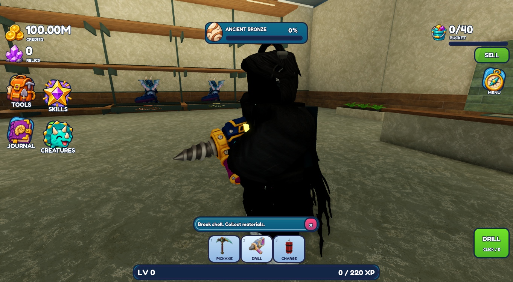
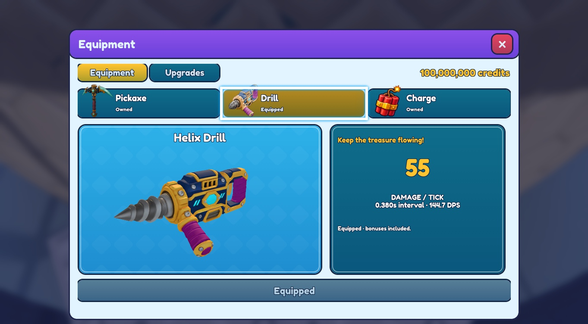

# Rodin drill replacement — published v241

Published to original place **94763223427049**, **2026-11-11 13:44:21 UTC**, on `planning/development-foundation`. The supplied drill replaces the equipped tool, equipment preview, workshop display and icon. Appearance remains subject to owner review.

The original package is untouched. `base_basic_pbr.fbx` retains its navy/gold housing, purple grips, turquoise accents and silver bit. No decimation: one internal shaft cut produces two meshes / **9,570 triangles**, preserving UVs and proportions. Separate diffuse, metallic, roughness and normal maps are mapped explicitly; the packed PBR map is unused. Supported emission uses a source-derived grayscale mask at strength 0.25. [Source, mapping and upload record](../../../assets/tools/rodin-drill/SOURCES.md).

The existing drill motion coordinator and bit motor remain. A drill-scoped reuse of the pickaxe's two-bone arm solve fixes the observed IK rotation failure. The rear hand holds the rear handle; the support hand reaches the supplied auxiliary grip. The final holding frame is higher and closer to the chest. The housing is welded and only the silver bit rotates about its shaft.

## Focused checks

Three memory-only sessions, with no broad regression suite:

- **52 seconds:** equipped assembly check exposed a downward-hanging tool; stopped and corrected the hand rotation solve.
- **210 seconds:** checked holding, one 0.5-second drilling hold, bit rotation, release, tool switch, equipment preview and icon. Target HP **180 → 106 → 51** agrees with the existing 55 damage plus first-hit precision bonus. Sampled housing transforms remained fixed relative to Handle while the bit rotated; bit angle stopped changing on release. Switching selected Pickaxe, removed the drill and cleared running state. Pointer/camera tool fallbacks extended capture time; a misdirected category click caused one additional memory-only drill tick on a different plate. Native desktop selection completed the equipment capture.
- **55 seconds, holding only:** confirmed that the auxiliary hand was out of reach, corrected only the holding offset, and checked both grips before the final in-hand capture. No further drilling. The final offset was applied to the canonical recipe and rebuilt in Edit.

The existing 100M Studio preview and ownership unlocks were used unchanged. No added grants, purchases, production-data writes, reset or save-generation changes. Prices, upgrades, damage, cooldown and reach are unchanged. Pickaxe, explosive, environment, rooms, training and UI layout were not edited.

Final canonical source readback matches all six live changed modules; StyLua passes. Both source meshes and their complete PBR mapping are present in the equipped template, preview and workshop. The superseded source is absent. Temporary helpers are absent and Studio is stopped in **Edit**. Private native before/final backups and masters: `Backups/RodinDrill_20261111/`; [delivery identity](delivery.json).

Remaining limits: other avatars/R6, respawn, multiplayer, touch/gamepad usability and long sessions were not tested. The final closer holding offset was checked at idle; extreme aiming poses were not repeated. The dark owner avatar obscures some hand detail in the capture. Roblox metal highlights differ from the Blender icon. A pre-existing pickaxe texture-delivery warning was observed and left outside scope. Functional observations do not imply owner visual approval.
