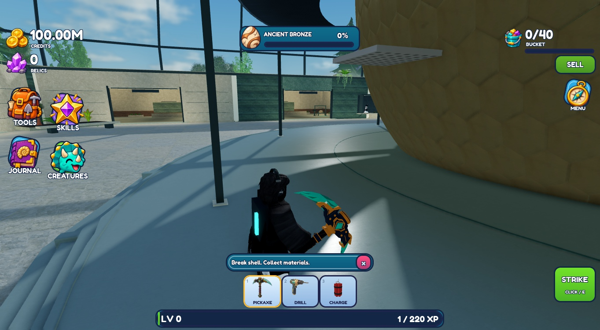
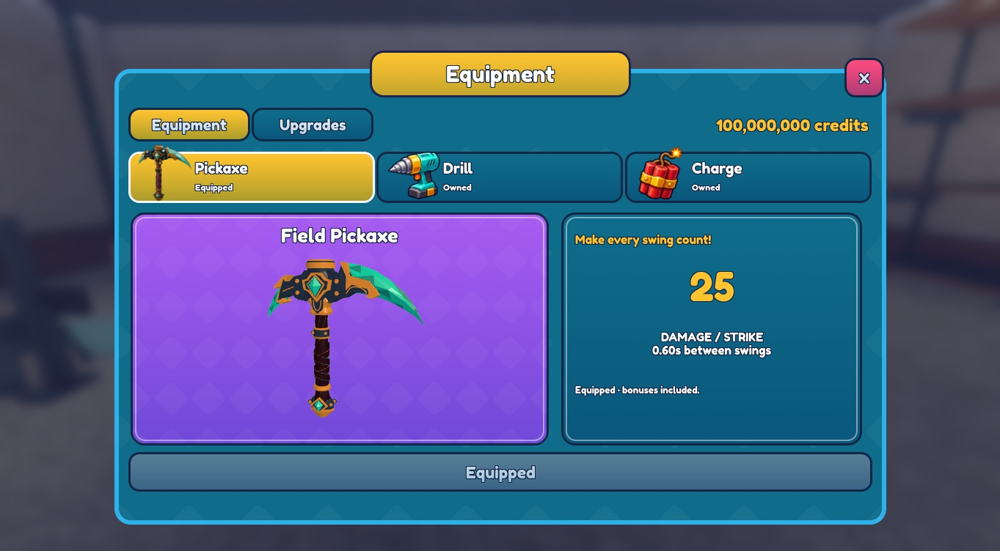
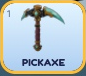

# Exact Rodin pickaxe replacement - v238

Published to original place **94763223427049** on **2026-11-11 at 12:22:57 UTC**, branch `planning/development-foundation`. The owner-selected FBX replaces the rejected v235 pickaxe in the equipped tool, equipment preview, workshop display and hotbar/inventory icon. Menus and other tools were not redesigned. Implementation is delivered for review; owner visual approval is not claimed.

**38,016 triangles / seven visible meshes / seven source materials**, reduced from 63,928 triangles / 217 objects. Only four dense grip-edge objects were simplified. The functioning Tool has one additional invisible Handle and seven welds. See [source and conversion record](../../../assets/tools/rodin-pickaxe/SOURCES.md) and [geometry metadata](../../../assets/tools/rodin-pickaxe/geometry.json).

## Actual captures

In hand, following the single strike:

Equipment preview and matching category artwork:

Actual-size hotbar crop, **86 x 76 pixels**, with no resizing:

These are actual Studio runtime captures, not mockups or Blender renders. The 100M balance visible in them is the existing memory-only Studio preview setting; this task added no grants and touched no production profiles.

## Focused verification

One **76-second** Studio session, 12:19:41-12:20:57 UTC. Checked assembled appearance, equipped grip, one ordinary mouse strike, equipment preview and icon. Seven meshes remained welded to the Handle. Target HP changed **180 to 146**: the existing 25-damage strike with its 1.35 precision bonus, rounded to 34. Damage, cooldown, range, progression, ownership and animation logic were not changed. Only the source model, grip-relative tip marker and pickaxe presentation paths changed.

The initial Edit preview exposed separated parts from resetting imported mesh transforms; the complete-assembly transform fixed this before Play. Final source readback matched all six changed canonical modules, StyLua passed, and all four pickaxe destinations contain seven meshes with the source PBR maps. The superseded active source was removed. No purchases, other-tool tests, skills, settings, mobile menus, full-world audits or microscopic contact measurements were performed.

No concrete assembly or strike regression remained in this check. Roblox's preview/world lighting makes the metal darker and highlights flatter than the private Blender studio render; source color, metalness and roughness values were preserved. Other avatars, respawn and long-session behavior were not retested. The supplied design's implementation remains subject to owner review.

Studio is stopped in **Edit**. Runtime platform and Edit preview helpers are absent. Private before/final native backups and source masters are under `Backups/RodinPickaxe_20261111/`; [delivery.json](delivery.json) records hashes and publication evidence. Fixed save generation and player data remain unchanged. No further screens or systems were extended.
