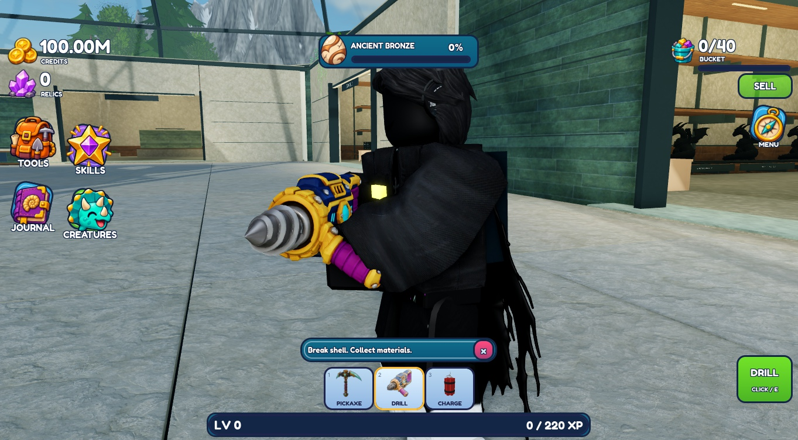
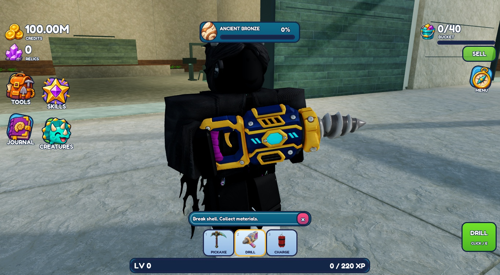
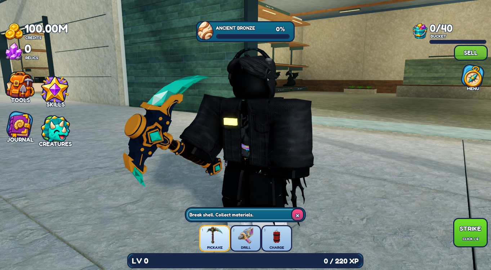

# Tool grip polish — published v244

Published to original place **94763223427049** at **2026-11-11 14:35:55 UTC**, branch `planning/development-foundation`. The owner approved the pickaxe/drill designs before this work. Both models, geometry, materials and icons are preserved. **Corrected poses await owner review.**

The owner's R15 avatar **Alrimi / UserId 291892217** reproduced the fault: the rear wrist sat behind the torso, burying the drill housing. The old reach fallback translated the entire tool toward/through the chest; a purely outward elbow pole raised the arm, and orientation derived from already-posed parts could carry twist forward.

The existing two-bone drill solve now uses stable bind frames and downward/outward elbow directions. A forward diagonal brace puts the primary hand at the rear handle and the supporting hand at the supplied side grip. The character turns into that brace when drilling; only heading changes. Downward aiming lifts the holding frame to keep the auxiliary grip reachable. Per-frame arm overrides are restored before the Animator runs and on release; the coordinator now includes both left elbow and wrist in its release capture. Pickaxe inspection showed no visible contact failure, so its grip/animation source remains unchanged.

## Actual checks and limits

Three memory-only sessions: **114 seconds** for before inspection, **329 seconds** for initial correction/interaction/camera diagnosis, and **72 seconds** for the affected aiming/cleanup recheck. The middle pass was longer than intended because changing the screenshot camera redirected live mouse targeting. Ordinary E-held drilling produced server-confirmed material/XP changes; release stopped running, and the bit remained the only motor-driven mesh. No prices, damage, timings, reach or other balance code changed.

Final idle, active-motion, moderate upward/downward aim, drill→pickaxe switch and unequip were inspected with the owner's unchanged appearance. The final active/up/down images use a temporary client helper invoking the **existing motion phase** at controlled visual targets, with no damage request in that recheck. This avoids the camera changing mouse aim. The support grip remained reached at the three captured angles. Switching restored AutoRotate, cleared running, removed all drill IK/target helpers, and unequipping relaxed both arms. The helper was removed in Edit before final save/publication. [Observed checks](checks.json).

The bulky black sleeves obscure finger detail and the exact wrist contour; their shape was not changed. R6, other body scales/clothing, extreme aiming, locomotion/training combinations, respawn and multiplayer appearance remain unverified. No live-client test or broad regression suite was run. Owner test mode, UI, environment and player data are unchanged. Studio is stopped in **Edit**; native recovery is private under `Backups/ToolGripPolish_20261111/`. Source readback matches the three changed modules and StyLua passes.

## Before and after

| View | Actual image |
| --- | --- |
| Before drill front | [before-drill-front.png](before-drill-front.png) |
| Before drill side | [before-drill-side.png](before-drill-side.png) |
| Before pickaxe | [before-pickaxe.png](before-pickaxe.png) |
| Final drill front / three-quarter | [final-drill-front.png](final-drill-front.png) |
| Final drill side | [final-drill-side.png](final-drill-side.png) |
| Final active drilling motion | [active-drilling.png](active-drilling.png) |
| Moderate upward aim | [aim-up.png](aim-up.png) |
| Moderate downward aim | [aim-down.png](aim-down.png) |
| Final pickaxe hold | [final-pickaxe.png](final-pickaxe.png) |
| Arms cleared after unequip | [unequipped.png](unequipped.png) |
| Approved drill equipment preview, reused unchanged | [drill-equipment.png](drill-equipment.png) |

